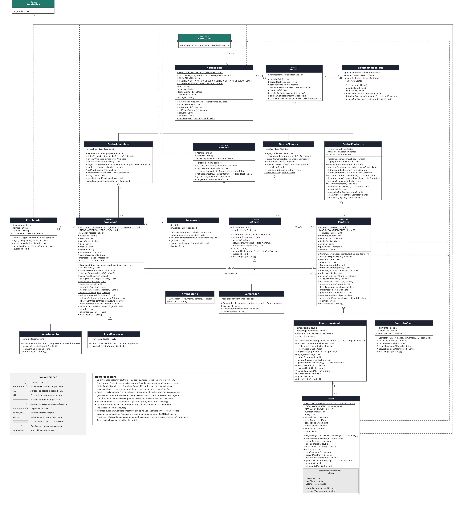

# Entrega 1 — Definición del problema y requerimientos

## Descripción del problema o contexto de automatización

### 1. Contexto

La administración de inmuebles en arriendo se eligió como contexto de este proyecto por ser un proceso cotidiano propio de agentes independientes o pequeñas inmobiliarias que gestionan más de 30 apartamentos y locales comerciales simultáneamente, en su mayoría, de forma manual. En el contexto conviven de forma natural entidades bien diferenciadas como las propiedades, los contratos, los arrendatarios y los pagos. Además de tener reglas de negocio claras y verificables, como el incremento anual del canon, el cálculo de intereses por mora, a lo que se suma, en el caso del agente inmobiliario, la necesidad de administrar simultáneamente inmuebles de distintos propietarios y de dar seguimiento a los clientes interesados en cada uno de ellos.

### 2. Actores

La gestión de inmuebles a través de un agente inmobiliario es un proceso en el que intervienen cuatro actores principales. El agente inmobiliario actúa como intermediario: no es dueño de los inmuebles que gestiona, sino que representa a distintos propietarios y es responsable de mantener actualizada la disponibilidad de cada inmueble (en arriendo, en venta o ya cerrado), formalizar los contratos, gestionar los datos de contacto de los interesados que consultan por una propiedad, y coordinar las visitas o citas de seguimiento con cada uno de ellos. El propietario delega la gestión de su inmueble al agente, sin encargarse directamente del cobro ni del contacto con arrendatarios o compradores. El interesado o cliente potencial manifiesta interés en un inmueble y es contactado por el agente durante el proceso de negociación, antes de convertirse en arrendatario o comprador. Finalmente, el arrendatario o comprador es quien ocupa o adquiere el inmueble una vez cerrado el proceso, y realiza los pagos periódicos o el pago acordado según corresponda.

### 3. Proceso actual

Actualmente este proceso se lleva de forma manual, apoyado en hojas de cálculo o cuadernos donde se registran los contratos y los pagos recibidos, lo que obliga al administrador a calcular a mano tanto el incremento anual del canon de arrendamiento como los intereses generados cuando un pago se realiza fuera de la fecha límite, así cómo actualizar manualmente todas las relaciones entre clientes y propiedades una vez se cierra un proceso de arrendamiento. A esto se suma que el agente debe llevar por separado, generalmente en agendas o mensajes sueltos, el registro de las personas interesadas en cada inmueble y las fechas en que debe contactarlas nuevamente, así como revisar manualmente las fechas de vencimiento de los contratos vigentes para saber cuándo un inmueble volverá a estar disponible y así poder ofrecerlo.

### 4. Dolor

El dolor central de este proceso es la ausencia de control automático y centralizado sobre la cartera de inmuebles, contratos y clientes, lo que se manifiesta en dos frentes. Por un lado, en el frente financiero: al calcularse a mano, el incremento anual no siempre se aplica de manera consistente entre los distintos inmuebles y los atrasos en los pagos no generan intereses de mora de forma automática, lo que se traduce en pérdidas económicas por moras que no se cobran a tiempo y en discusiones con los arrendatarios sobre cuánto deben realmente. Por otro lado, en el frente comercial: al no existir un mecanismo que alerte sobre contratos próximos a vencer ni un registro centralizado de interesados y sus fechas de seguimiento, el agente pierde oportunidades de negocio, interesados a los que no se contacta a tiempo terminan comprando o arrendando con otro agente, y contratos vencidos tardan en reofrecerse en el mercado. En ambos casos, la causa raíz es la misma: el agente debe revisar manualmente cada registro para tener una visión completa del estado de su cartera, lo que consume un tiempo considerable y es propenso a errores y olvidos.

### 5. Impacto

Un sistema que automatice el registro de propiedades y arrendatarios, la generación de contratos, el cálculo de incrementos anuales e intereses de mora, y la consulta del estado de cartera permitiría reducir de manera significativa el tiempo operativo del agente. A esto se suma la posibilidad de centralizar la gestión de clientes interesados y sus fechas de seguimiento, y de identificar con anticipación los contratos próximos a vencer para reactivar la oferta del inmueble sin depender de la memoria o revisión manual del agente, mejorando así tanto la eficiencia comercial como la experiencia de propietarios, arrendatarios y compradores.

## Requerimientos

| ID | Descripción | Actor | Prioridad | Criterio de aceptación |
|---|---|---|---|---|
| RF-01 | Registrar una propiedad con dirección, área, valor base, tipo (Apto, Casa, etc) y modo (Arriendo o venta) | Agente | Alta | No se permiten dos propiedades con la misma dirección; el sistema exige tipo, área y valor base mayores a cero |
| RF-02 | Registrar un arrendatario con documento, nombre y contacto | Agente | Alta | No se permiten dos arrendatarios con el mismo número de documento |
| RF-03 | Crear un contrato asociando una propiedad disponible y un arrendatario | Agente | Alta | El contrato solo se crea si la propiedad existe, está disponible y el arrendatario existe |
| RF-04 | Impedir crear un contrato sobre una propiedad que ya está arrendada | Agente | Alta | Al intentar crear un contrato sobre una propiedad con estado "arrendada", el sistema rechaza la operación y muestra el motivo |
| RF-05 | Registrar el pago mensual de un contrato | Agente | Alta | El pago solo se registra si el contrato está activo; queda asociado a la fecha y al periodo que cubre |
| RF-06 | Calcular automáticamente el interés de mora cuando un pago se registra fuera de la fecha límite | Agente | Alta | Si la fecha de pago es posterior a la fecha límite, el sistema calcula el interés según los días de atraso y lo suma al valor a pagar |
| RF-07 | Aplicar el incremento anual del canon al cumplirse un año de contrato | Agente | Media | Al cumplirse 12 meses desde el inicio (o última actualización) del contrato, el sistema recalcula el canon con el porcentaje definido, sin intervención manual |
| RF-08 | Consultar el historial de pagos de un contrato | Agente | Media | Se listan todos los pagos del contrato ordenados por fecha, incluyendo los que tuvieron mora |
| RF-09 | Listar los contratos con pagos en mora | Agente | Alta | Se muestran solo los contratos activos que tienen al menos un pago vencido sin registrar |
| RF-10 | Terminar un contrato y liberar la propiedad | Agente | Media | Al terminar el contrato, su estado cambia a "finalizado" y la propiedad vuelve a estar disponible para un nuevo contrato |
| RF-11 | El sistema debe permitir al agente registrar un interesado (nombre, contacto) asociado a mínimo un inmueble | Agente | Alta | El actor interesado solo existe si está asociado a mínimo un inmueble. El sistema lo crea exigiendo nombre y contacto. |
| RF-12 | Registrar y consultar fechas de seguimiento para un interesado | Agente | Alta | Las fechas registradas quedan guardadas correctamente y al consultar se imprimen en pantalla todas las citas pendientes |
| RF-13 | Consultar inmuebles disponibles en cada modalidad | Agente | Media | Al llamar a esta funcionalidad se muestran correctamente todos los inmuebles correctamente clasificados por modalidad (Renta o venta) |
| RF-14 | Diferenciar entre apartamentos, locales comerciales, aplicando reglas propias de cada tipo | Agente | Media | Al calcular el depósito de garantía, un apartamento exige un mes de canon y un local comercial exige dos meses más el IVA correspondiente; ambos cálculos se obtienen sin condicionales explícitos fuera de la clase del inmueble |
| RF-15 | Consultar sobre los contratos que vencen dentro de los próximos 30 días | Agente | Alta | Se listan correctamente todos los contratos que se vencen en el tiempo requerido |
| RNF-01 | Guardar la información en archivos planos entre ejecuciones | Sistema | Alta | Al reiniciar el sistema, las propiedades, contratos, arrendatarios y pagos siguen disponibles tal como quedaron guardados |
| RNF-02 | Validar que los montos y fechas ingresados sean coherentes antes de guardar | Sistema | Alta | El sistema rechaza valores negativos, fechas inválidas o incoherentes (ej. fecha de pago anterior al inicio del contrato) antes de guardar cualquier dato |

## Próximos pasos

### 1. Conformación del equipo

| Integrante | Rol asignado | Responsabilidades principales |
|---|---|---|
| Santiago Serrano | Diseño | Interfaces, experiencia de usuario y diagramas (UML/mockups) de cómo se ve y navega el sistema. |
| Miguel Delgado | Producto | Define qué se construye: requisitos, prioridades y que la solución resuelva el problema real. |
| Jose Gómez Mosquera | Integración | Programa las clases en POO y conecta los módulos (clientes, propietarios, arriendos) entre sí y con la base de datos. |
| Juan Esteban | Integración | Programa las clases en POO y conecta los módulos (clientes, propietarios, arriendos) entre sí y con la base de datos. |
| Miguel Angel Preciado Jaramillo | Diseño | Interfaces, experiencia de usuario y diagramas (UML/mockups) de cómo se ve y navega el sistema. |
| Martin Fuentes Díaz | Calidad | Prueba que todo funcione: bugs, casos límite y que cumpla lo que Producto definió. |

### 2. Repositorio

- **Enlace al repositorio:** https://github.com/JyanZuix/inmobinarios-404
- **Docente invitado como colaborador:** @wilmertri (Wilmer Triana)

### 3. Plan hacia la Entrega 2

En un análisis preliminar, el grupo concluyó que los siguientes son los requerimientos previstos para una versión que atienda la necesidad principal de administrar los inmuebles ya existentes y los cálculos automatizados necesarios.

| Requerimiento | Clase Prevista | Tema de clase aplicado |
|---|---|---|
| RF-01. Registrar una propiedad (Apartamento o Local) con dirección, área y valor base. | `Propiedad` (abstracta), `Apartamento`, `LocalComercial` | Herencia, Métodos constructores, Encapsulamiento, Atributos y protección (protected en la clase padre, private en las hijas), Atributo estático (`contadorPropiedades`) |
| RF-02. Registrar un arrendatario con documento, nombre y contacto. | `Cliente` (abstracta), `Arrendatario` | Herencia, Encapsulamiento, Atributos y protección (protected, public) |
| RF-03. Crear un contrato asociando una propiedad disponible y un arrendatario. | `Contrato` (abstracta), `ContratoArriendo`, `ContratoVenta`, `Propiedad`, `Cliente` | Herencia, Métodos de negocio, Encapsulamiento, Atributos y protección (protected), Método estático (`generarNumeroContrato()`) |
| RF-04. Impedir crear un contrato sobre una propiedad que ya está arrendada. | `Contrato`, `Propiedad` | Métodos de negocio (`verificarDisponibilidad()`), Encapsulamiento |
| RF-05. Registrar el pago mensual de un contrato. | `ContratoArriendo`, `Pago` | Composición (`ContratoArriendo` ◆— `Pago`), Métodos vacíos (void), Encapsulamiento, Atributos y protección (private) |
| RF-06. Calcular automáticamente el interés de mora cuando un pago se registra fuera de la fecha límite. | `Pago` y su clase anidada `Mora` | Clase anidada, Métodos de negocio, Encapsulamiento, Atributos y protección (private) |
| RF-07. Aplicar el incremento anual del canon al cumplirse un año de contrato. | `ContratoArriendo` | Herencia (solo el contrato de arriendo tiene canon e incremento; la regla es la misma para cualquier tipo de propiedad), Métodos de negocio, Encapsulamiento |
| RF-08. Consultar el historial de pagos de un contrato. | `ContratoArriendo`, `Pago` | Colecciones (`List<Pago>` dentro de `ContratoArriendo`), Métodos de negocio |
| RF-09. Listar los contratos con pagos en mora. | `GestorContratos`, `Contrato`, `Pago` | Colecciones, Métodos de negocio |
| RF-10. Terminar un contrato y liberar la propiedad. | `Contrato`, `Propiedad`, `Cliente` | Métodos vacíos (void), Métodos de negocio, Encapsulamiento, Asociaciones (`contratoActual`) |
| RF-11. Registrar un interesado asociado a mínimo un inmueble. | `Interesado`, `Propiedad` | Métodos constructores, Encapsulamiento, Agregación y colecciones (interesados por propiedad) |
| RF-12. Registrar y consultar fechas de seguimiento para un interesado. | `Interesado` | Colecciones (fechas de seguimiento), Métodos de negocio |
| RF-13. Consultar inmuebles disponibles en cada modalidad. | `GestorInmuebles`, `Propiedad` | Colecciones, Métodos de negocio |
| RF-14. Diferenciar entre apartamentos y locales comerciales, aplicando reglas propias de cada tipo. | `Propiedad` (abstracta), `Apartamento`, `LocalComercial` | Herencia, Polimorfismo (`calcularDepositoGarantia()`), Constante estática (`TASA_IVA`) |
| RF-15. Consultar los contratos que vencen dentro de los próximos 30 días. | `GestorContratos`, `Contrato` | Colecciones, Métodos de negocio (`listarContratosPorVencer(dias)`) |

#### 3.1 Atributos, Métodos y Relaciones Entre Clases (Para Cada Requerimiento)

**RF-01: Registrar una propiedad**
- Clases: Propiedad (clase abstracta), Apartamento, LocalComercial.
- Atributos: direccion, area, valorBase, tipo, modo, estado; contadorPropiedades (estático); numHabitaciones (Apartamento); TASA_IVA (LocalComercial).
- Métodos: constructor Propiedad(direccion, area, valorBase, tipo, modo), validarDatos(), cambiarEstado(), getTotalPropiedades() (estático).
- Relaciones: Apartamento y LocalComercial heredan de Propiedad. Propiedad se agrega en GestorInmuebles, pertenece a un Propietario (1 a 0..*), agrupa a sus Interesado y se asocia con Contrato.
- Nota: el texto de RF-01 menciona "Casa" como ejemplo de tipo, pero el diagrama solo modela Apartamento y LocalComercial. Casa se presenta como ejemplo de extensión: bastaría con crear una nueva subclase de Propiedad que implemente calcularDepositoGarantia(), sin modificar el código existente.

**RF-02: Registrar un arrendatario**
- Clases: Cliente (abstracta), Arrendatario (y Comprador para el caso de venta).
- Atributos: documento, historial (en Cliente); nombre, contacto, fechasSeguimiento (heredados de Persona).
- Métodos: actualizarContacto(), obtenerInformacion(), describir() (abstracto, cada hija lo implementa).
- Relaciones: Arrendatario hereda de Cliente. Cliente se asocia con Contrato mediante el historial (1 a 0..*); puede tener varios contratos vigentes a la vez (getContratosVigentes(), ver decisión 18 de la sección 7).

**RF-03: Crear un contrato**
- Clases: Contrato (abstracta), ContratoArriendo, ContratoVenta.
- Atributos: numeroContrato, fechaInicio, fechaFin, estado, propiedad, cliente (en Contrato); contadorContratos (estático). canonActual pasa a ContratoArriendo.
- Métodos: crearContrato(), verificarDisponibilidad(), generarNumeroContrato() (estático), calcularMontoFinal() (abstracto).
- Relaciones: Una Propiedad y un Cliente tienen cada uno un historial de 0..* contratos; la Propiedad tiene además como máximo un contratoActual (0..1), mientras que un Cliente puede tener varios contratos vigentes. Cada Contrato referencia exactamente una Propiedad y un Cliente (Arrendatario en el arriendo, Comprador en la venta). GestorContratos agrega todos los contratos y es el único punto para crearlos (`agregarContrato()`), verificando que la propiedad esté en GestorInmuebles.

**RF-04: Impedir contrato en propiedad ocupada**
- Clases: Contrato, Propiedad.
- Atributos: estado y contratoActual (en Propiedad).
- Métodos: verificarDisponibilidad() (en Contrato); si la propiedad no está disponible, crearContrato() no crea el contrato y lanza una excepción con el motivo (decisión 29).
- Relaciones: Contrato consulta el estado de la Propiedad a la que referencia antes de crearse.

**RF-05: Registrar el pago mensual**
- Clases: Pago, ContratoArriendo.
- Atributos: idPago, fechaPago, periodoCubierto, montoPagado, estadoPago.
- Métodos: registrarPago(), validarPeriodo(); `GestorContratos.registrarPago(numeroContrato, periodo, fecha)` y `ContratoArriendo.registrarPago(periodo, fecha)` (decisión 50).
- Relaciones: Composición 1 a 0..*; un ContratoArriendo contiene sus objetos Pago y estos no existen sin él. ContratoVenta no tiene pagos periódicos (decisión 52).

**RF-06: Calcular automáticamente el interés de mora**
- Clases: Pago y su clase anidada Mora.
- Atributos: diasAtraso, tasaMora, valorInteres (en Mora); mora (en Pago).
- Métodos: calcularMora(), verificarFechaLimite() y diasAtraso() en Pago; calcularValor(canon) en Mora (decisión 51).
- Relaciones: Mora está anidada dentro de Pago, porque una mora no existe sin el pago atrasado que la origina. Pago.calcularMora() delega el cálculo en Mora.calcularValor().

**RF-07: Aplicar el incremento anual del canon**
- Clases: ContratoArriendo.
- Atributos: canonActual, porcentajeIncremento, ultimaFechaActualizacion.
- Métodos: aplicarIncrementoAnual(), verificarAniversario().
- Relaciones: Operación interna de ContratoArriendo. El incremento no depende del tipo de propiedad (Apartamento o LocalComercial): se aplica igual a todo contrato de arriendo. ContratoVenta no tiene incremento.

**RF-08: Consultar el historial de pagos**
- Clases: ContratoArriendo, Pago.
- Atributos: pagos : List<Pago> (en ContratoArriendo).
- Métodos: listarPagos(), que devuelve los pagos ordenados por fechaPago, incluidos los que tuvieron mora.
- Relaciones: Acceso desde ContratoArriendo a su lista de objetos Pago (composición).

**RF-09: Listar los contratos con pagos en mora**
- Clases: GestorContratos, Contrato, Pago.
- Atributos: contratos : List<Contrato> (en GestorContratos).
- Métodos: filtrarContratosEnMora(), verificarPagosVencidos().
- Relaciones: El gestor agrega todos los contratos (1 a 0..*) y recorre los pagos de cada ContratoArriendo.

**RF-10: Terminar un contrato y liberar la propiedad**
- Clases: Contrato, Propiedad, Cliente.
- Atributos: estado y fechaFin (en Contrato); estado y contratoActual (en Propiedad).
- Métodos: terminarContrato() (en Contrato), cambiarEstado() (en Propiedad).
- Relaciones: Al terminar (`terminarContrato(fecha)`), el Contrato pasa a "finalizado", la Propiedad vuelve a "disponible" y su contratoActual queda vacío (liberarContrato()). Una venta cerrada deja la propiedad "finalizado" y una venta cancelada (`cancelarVenta(fecha)`) la deja "disponible" (decisión 41). El contrato se conserva en el historial de la Propiedad y del Cliente; como deja de estar activo, ya no aparece en los contratos vigentes del Cliente.

**RF-11: Registrar un interesado**
- Clases: Interesado, Propiedad.
- Atributos: nombre, contacto (en Interesado); interesados : List<Interesado> (en Propiedad).
- Métodos: constructor de Interesado; la Propiedad lo agrega a su lista.
- Relaciones: Agregación 1 a 0..*; una Propiedad agrupa a sus interesados.

**RF-12: Registrar y consultar fechas de seguimiento**
- Clases: Interesado.
- Atributos: fechasSeguimiento : List<Date>.
- Métodos: registrarSeguimiento(fecha), consultarSeguimientos().
- Relaciones: Operación interna de Interesado.

**RF-13: Consultar inmuebles disponibles por modalidad**
- Clases: GestorInmuebles, Propiedad.
- Atributos: inmuebles : List<Propiedad> (en GestorInmuebles); modo y estado (en Propiedad).
- Métodos: listarDisponibles(modalidad).
- Relaciones: El gestor agrega todas las propiedades (1 a 0..*).

**RF-14: Reglas propias por tipo de inmueble**
- Clases: Propiedad, Apartamento, LocalComercial.
- Atributos: TASA_IVA = 0.19 (constante estática en LocalComercial).
- Métodos: calcularDepositoGarantia() (abstracto en Propiedad; Apartamento cobra un mes de canon y LocalComercial dos meses más IVA).
- Relaciones: Herencia y polimorfismo; quien llama no pregunta de qué tipo es la propiedad.

**RF-15: Consultar contratos próximos a vencer**
- Clases: GestorContratos, Contrato.
- Atributos: contratos : List<Contrato> (en GestorContratos); fechaFin y estado (en Contrato).
- Métodos: listarContratosPorVencer(dias) : List<Contrato>; para este requerimiento se llama con dias = 30 y devuelve los contratos activos cuya fechaFin cae dentro de ese plazo.
- Relaciones: El gestor recorre su colección de contratos. RF-17 usa el mismo criterio para generar la notificación automática.

### 4. Registro de decisiones

| Decisión | Alternativas consideradas | Por qué | Consecuencia |
|---|---|---|---|
| Escogimos dominio de negocio de bienes inmobiliarios con enfoque en Agentes inmobiliarios | Consideramos enfocarnos en la parte de administración solamente de inmuebles, para propietarios de múltiples apartamentos. | La elección permite más relacionamientos entre clases y es más aplicable al contexto cercano a los integrantes del grupo. | El sistema cambia de tener un enfoque de cálculos financieros y automatización de una base de datos, a ser un aplicativo de sistema de inventarios que se enfoca en la parte comercial, de seguimientos, etc. |
| Los inmuebles se especializan por tipo: Apartamento y local comercial, cada uno con reglas propias | Tratar todos los inmuebles como una sola entidad genérica con los mismos campos y reglas | Un tipo genérico no permite modelar de manera especializada el comportamiento de cada inmueble, quitándole funcionalidad real al sistema que no podría diferenciar las reglas de negocio entre un local y un apartamento. | Se requiere una jerarquía de clases, en donde el inmueble sea la clase padre que hereda a los tipos de inmueble, estos difieren en reglas, métodos y comportamiento específico. |
| El contrato es una entidad con comportamiento propio, es el encargado de calcular el canon, la mora y alerta automáticamente su propio vencimiento. | Dejar estos cálculos como lógica externa o como responsabilidad de actualizar los datos del agente | El dolor central identificado fue precisamente que estos cálculos se hacen de forma manual. Con esto garantizamos que esta entidad cumpla con el requerimiento y le permite a todas las demás clases delegar sus cálculos a una sola entidad con la misma lógica. | El contrato debe encapsular sus propias reglas cómo lo son los incrementos, moras y vencimientos. |

### 5. Bitácora de uso de IA

| Herramienta | Qué se solicitó | Qué se recibió | Qué se corrigió |
|---|---|---|---|
| Claude – Sonnet 4.6 | Brainstorming de contextos | Se aceptó una lista de distintos contextos en dónde puede ser aplicable un sistema de POO | Se ajustó el alcance del proyecto de gestión de inventario, a una herramienta comercial en el mercado inmobiliario. |
| Gemini 3.5 Flash Lite | Sinterización de Información | La sinterización de información que teníamos previamente organizada de manera diferente. | Se plasmó dicha información en el documento ya estando mejor organizada con el fin de que se vea mejor y menos ruidoso visualmente. |
| Claude – Sonnet 4.6 | Pedimos a la IA la traducción del archivo Word al README.md | Se recibió el archivo README.md con el mismo contenido y redacción del Word, en formato Markdown | No se corrigió nada, ya que las correcciones se hicieron sobre el archivo de Word; se hizo una revisión leyendo y comparando el output del README.md con el Word |

---

# Entrega 2 — Diseño orientado a objetos (diagrama UML)

Esta entrega modela el sistema para un **agente inmobiliario** que gestiona su propio inventario de inmuebles de terceros, tanto en **arriendo como en venta**, junto con sus clientes, interesados, contratos, pagos y fechas de seguimiento. El texto de la Entrega 1 (problema, actores, requerimientos RF-01 a RF-15) no se modificó, salvo las tablas 3 y 3.1 del plan, que se actualizaron para coincidir con el diagrama; esta sección agrega el diagrama, los requerimientos de notificaciones y la explicación de cómo se aplica cada concepto.

## 1. Diagrama de clases

El diagrama contiene 19 clases, 2 interfaces y 1 clase anidada (`Mora`, dentro de `Pago`). Las clases de utilidad `ArchivoPlano` y `Utilidades` no aparecen porque no son del dominio (decisiones 15 y 30).

| Grupo | Elementos | Rol en el sistema |
|---|---|---|
| Inmuebles | `Propiedad` (abstracta), `Apartamento`, `LocalComercial` | Inventario del agente; cada tipo tiene sus reglas |
| Personas | `Persona` (abstracta), `Cliente` (abstracta), `Arrendatario`, `Comprador`, `Propietario`, `Interesado` | Quién arrienda, compra, es dueño o está interesado |
| Contratación | `Contrato` (abstracta), `ContratoArriendo`, `ContratoVenta`, `Pago` (con `Mora` anidada) | Formalización y cobros |
| Alertas | `Notificacion` | Aviso guardado y marcable como atendido |
| Gestión | `Gestor` (abstracta), `GestorInmuebles`, `GestorClientes`, `GestorContratos`, `SistemaInmobiliario` | Colecciones del sistema, consultas sobre ellas, y guardar y cargar todo el sistema (`GestorClientes`, `Gestor` y `SistemaInmobiliario` se agregaron en la implementación; ver decisiones 20 a 22) |
| Interfaces | `Persistible`, `Notificable` | Capacidades que comparten clases sin relación de herencia |

**Relaciones principales**

| Relación | Tipo | Multiplicidad |
|---|---|---|
| `Propietario` — `Propiedad` | Agregación | 1 – 0..* |
| `Propiedad` — `Interesado` | Agregación, navegable en ambos sentidos (un interesado puede estar en varias propiedades) | 0..* – 1..* |
| `GestorInmuebles` — `Propiedad`; `GestorClientes` — `Cliente`; `GestorContratos` — `Contrato` | Agregación | 1 – 0..* |
| `Gestor` (los tres gestores) — `Notificacion` | Agregación | 1 – 0..* |
| `ContratoArriendo` — `Pago` | Composición | 1 – 0..* |
| `Propiedad` — `Contrato` y `Cliente` — `Contrato` | Asociación `historial` (todos los contratos) | 1 – 0..* |
| `Propiedad` — `Contrato` | Asociación `contratoActual` (con flecha) | 1 – 0..1 |
| `Notificable` → `Notificacion` | Dependencia «usa» | — |

La Entrega 1 describía la relación entre `Contrato`, `Propiedad` y `Arrendatario` como 1 a 1. Con el historial completo de contratos pasó a ser 1 a 0..*, y se conservó `contratoActual` para mantener la relación fuerte con el contrato vigente (ver decisión 3 de la sección 7). Después, `Cliente` dejó de tener `contratoActual` porque un cliente puede tener varios contratos vigentes; solo la `Propiedad` lo conserva (ver decisión 18 de la sección 7).

## 2. Cambios respecto a la Entrega 1

- **Contrato** pasa a ser abstracto, con `ContratoArriendo` (canon, incremento anual, pagos) y `ContratoVenta` (valor de venta, cuota inicial, saldo financiado). `canonActual`, `porcentajeIncremento` y `ultimaFechaActualizacion` ahora viven en `ContratoArriendo`.
- **Arrendatario** deja de ser una clase independiente y pasa a ser hija de `Cliente` (abstracta), junto con `Comprador`. RF-02 y RF-03 se interpretan como aplicables a cualquier `Cliente` y a ambos tipos de contrato, sin modificar su texto.
- **Propietario** se modela como clase propia, porque el agente gestiona inmuebles de varios dueños (actor descrito en la sección "Actores").
- Los requerimientos que en la versión original de la Entrega 1 se marcaron como "no necesita una clase específica" (ya corregido en la tabla 3) quedan ubicados así: RF-04 → `Contrato.verificarDisponibilidad()`; RF-06 → `Pago.calcularMora()` con la clase anidada `Mora`; RF-07 → `ContratoArriendo.aplicarIncrementoAnual()`; RF-10 → `Contrato.terminarContrato()` y `Propiedad.cambiarEstado()`.
- RF-15 queda ubicado en `GestorContratos.listarContratosPorVencer(dias)`.
- RF-08 no usa un método `ordenarPorFecha()` aparte: `listarPagos()` devuelve los pagos ordenados por fecha.
- Se agregan los requerimientos de notificaciones RF-16 a RF-21 (sección 3).

## 3. Requerimientos nuevos: notificaciones

Los requerimientos RF-01 a RF-15 y RNF-01/02 se mantienen sin cambios. Los siguientes responden a la necesidad de que el sistema le avise al agente qué requiere atención, en lugar de depender de su revisión manual (el dolor descrito en la Entrega 1). RF-17 automatiza el aviso sobre lo que RF-15 permite consultar a demanda.

| ID | Descripción | Actor | Prioridad | Criterio de aceptación |
|---|---|---|---|---|
| RF-16 | Notificar al agente los pagos en mora o por vencer | Agente | Alta | Se genera una notificación por cada pago cuya fecha límite ya pasó sin registrarse o vence en los próximos 7 días; un pago ya registrado no genera notificación |
| RF-17 | Notificar al agente los contratos próximos a vencer | Agente | Alta | Se genera una notificación por cada contrato activo cuya fecha de fin cae dentro de los próximos 30 días; los contratos finalizados no generan notificación |
| RF-18 | Notificar al agente las fechas de seguimiento de los interesados | Agente | Alta | Se genera una notificación por cada interesado con una fecha de seguimiento pendiente que sea hoy o ya haya pasado |
| RF-19 | Notificar al agente los seguimientos y la situación contractual de los clientes | Agente | Media | Un cliente con seguimiento pendiente hoy o vencido genera notificación; un cliente cuyo contrato actual vence en los próximos 30 días o tiene pagos en mora genera una notificación que indica el motivo |
| RF-20 | Consultar las notificaciones pendientes | Agente | Alta | Se listan todas las notificaciones no atendidas de todos los gestores, con tipo, mensaje y fecha del evento, ordenadas por fecha del evento y sin clasificación por prioridad |
| RF-21 | Marcar una notificación como atendida | Agente | Media | Al marcarla, deja de aparecer en las pendientes; si el mismo evento se recolecta de nuevo no se crea una notificación duplicada; las notificaciones y su estado se conservan al reiniciar el sistema |

**Trazabilidad de los nuevos requerimientos**

| Requerimiento | Clases | Concepto aplicado |
|---|---|---|
| RF-16 | `Pago`, `GestorContratos`, `Notificacion` | Interfaz `Notificable`, polimorfismo, colecciones |
| RF-17 | `Contrato`, `GestorContratos`, `Notificacion` | Interfaz `Notificable`, polimorfismo, colecciones |
| RF-18 | `Interesado`, `GestorInmuebles`, `Notificacion` | Interfaz `Notificable`, colecciones |
| RF-19 | `Cliente`, `GestorContratos`, `Notificacion` | Interfaz `Notificable`, herencia, colecciones |
| RF-20 | `GestorInmuebles`, `GestorContratos`, `Notificacion` | Colecciones, métodos de negocio |
| RF-21 | `Notificacion` | Encapsulamiento, interfaz `Persistible` |

## 4. Aplicación de los conceptos de la clase

En cada tabla se indica dónde aparece el concepto en el diagrama, para qué sirve en este diseño y qué decisión lo originó. Cuando algo no está aplicado todavía pero podría estarlo, se indica explícitamente.

### 4.1 Clases, herencia y encapsulamiento

| Dónde aparece | Para qué sirve | Decisión que lo originó |
|---|---|---|
| `Propiedad` (abstracta) → `Apartamento`, `LocalComercial` | Los atributos comunes (dirección, área, valor base, estado) se escriben una vez; cada tipo agrega sus reglas | Especializar los inmuebles por tipo (Entrega 1, decisión 2) |
| `Cliente` (abstracta) → `Arrendatario`, `Comprador` | Un cliente comparte documento, nombre y contacto, pero el arrendatario y el comprador se diferencian (por ejemplo, `Comprador.requiereFinanciamiento`) | Decisión 2 de la sección 7 |
| `Contrato` (abstracta) → `ContratoArriendo`, `ContratoVenta` | Arriendo y venta tienen fechas y estado en común, pero cálculos y datos distintos | Decisión 1 de la sección 7 |
| `Propietario`, `Interesado` como clases propias | El agente gestiona inmuebles de varios dueños y da seguimiento a personas que todavía no son clientes | Actores de la Entrega 1; RF-11 y RF-12 |
| `GestorInmuebles`, `GestorClientes`, `GestorContratos` (hijos de `Gestor`) | Concentran las listas (`List<Propiedad>`, `List<Cliente>`, `List<Contrato>`; las notificaciones están en el padre) y las consultas sobre ellas (RF-09 `filtrarContratosEnMora()`, RF-13 `listarDisponibles()`, RF-15 `listarContratosPorVencer(dias)`, RF-20), además de guardar y cargar lo suyo (RNF-01) | Plan de la Entrega 1 (colecciones); decisiones 20 y 21 |
| `SistemaInmobiliario` | Tiene los tres gestores y los coordina: los crea con sus dependencias y guarda, carga y recolecta notificaciones en el orden correcto | Decisión 22 |
| Visibilidad: `-` privado, `#` protegido, `+` público | Los atributos específicos de una clase son privados; los de las clases abstractas son protegidos para que sus hijas los usen; los métodos de negocio son públicos | Encapsulamiento previsto desde la Entrega 1 |

### 4.2 Atributos y métodos estáticos

En el diagrama aparecen subrayados.

| Dónde aparece | Para qué sirve | Decisión que lo originó |
|---|---|---|
| `Propiedad.contadorPropiedades` y `Propiedad.getTotalPropiedades()` | Contar cuántas propiedades se han registrado sin necesitar una instancia concreta | Decisión 7 de la sección 7 |
| `Contrato.contadorContratos` y `Contrato.generarNumeroContrato()` | Asignar a cada contrato un número consecutivo único (`numeroContrato`), sea de arriendo o de venta | Decisión 7 de la sección 7 |
| `LocalComercial.TASA_IVA = 0.19` | Constante compartida por todos los locales para calcular el depósito de garantía (dos meses de canon más IVA, RF-14) | Reglas propias por tipo (RF-14) |
| `Pago.TASA_MORA_DIARIA = 0.001` | Tasa de mora única para todos los contratos (0,1 % del canon por cada día de atraso); cada `Mora` la recibe al crearse | RF-06; decisión 51 |

`GestorContratos.filtrarContratosEnMora()` es un método de instancia, no estático, porque trabaja sobre la lista de contratos de cada gestor.

### 4.3 Clases anidadas

| Dónde aparece | Para qué sirve | Decisión que lo originó |
|---|---|---|
| `Mora` anidada dentro de `Pago` (`diasAtraso`, `tasaMora`, `valorInteres`, `calcularValor()`) | Una mora no existe sin el pago atrasado que la origina y ninguna otra clase la usa; anidarla agrupa sus datos y el cálculo del interés sin exponerla en el resto del sistema. `Pago.calcularMora()` delega en ella | Decisión 7 de la sección 7; RF-06 |
| `Notificacion` no se anida | La comparten varias clases y ambos gestores, así que tiene sentido que sea una clase independiente | Decisión 5 de la sección 7 |

### 4.4 Interfaces

| Interfaz | Métodos | Implementada por | Para qué sirve |
|---|---|---|---|
| `Persistible` | `guardar()`, `cargar()` | `Propiedad`, `Persona` (y por herencia `Cliente` e `Interesado`), `Contrato`, `Pago`, `Propietario`, `Notificacion` | Garantiza que todo objeto que debe sobrevivir entre ejecuciones sepa guardarse y cargarse (RNF-01). Se implementa una sola vez en la clase padre y las hijas la heredan |
| `Notificable` | `generarNotificaciones(hoy) : List<Notificacion>` | `Pago`, `Contrato`, `Persona` (y por herencia `Interesado` y `Cliente`) | Garantiza que todo objeto que puede requerir atención del agente sepa generar sus avisos (RF-16 a RF-19). Depende de `Notificacion` (relación «usa») |

Se usan interfaces y no una clase abstracta común porque las clases que las implementan no están emparentadas entre sí (`Pago`, `Cliente`, `Interesado`) y cada una ya pertenece a su propia jerarquía.

`Persistible` está implementada por los objetos de datos pero no por los gestores. Guardar y cargar todo el sistema de una vez lo hacen los gestores con `guardarTodo()` y `cargarTodo()`, definidos en la clase abstracta `Gestor` y coordinados por `SistemaInmobiliario` (decisiones 21 a 24). `ContratoArriendo.guardar()` delega en los `Pago` de su lista.

### 4.5 Polimorfismo

| Método | Declarado en | Cada clase lo resuelve así | Requerimiento |
|---|---|---|---|
| `calcularDepositoGarantia()` | `Propiedad` (abstracto) | `Apartamento`: un mes de canon. `LocalComercial`: dos meses más el IVA | RF-14 |
| `calcularMontoFinal()` | `Contrato` (abstracto) | `ContratoArriendo` calcula el monto de un arriendo; `ContratoVenta` el de una venta con cuota inicial y saldo financiado | RF-03, RF-07 |
| `describir()` | `Cliente` (abstracto) | `Arrendatario` y `Comprador` devuelven su descripción propia | RF-02 |
| `generarNotificaciones()` | Interfaz `Notificable` | `Pago`, `Contrato`, `Interesado` y `Cliente` generan avisos distintos (mora, vencimiento, seguimiento) | RF-16 a RF-19 |
| `guardar()` / `cargar()` | Interfaz `Persistible` | Cada clase guarda sus propios datos | RNF-01 |

El beneficio concreto de este diseño es que quien llama no necesita preguntar de qué tipo es el objeto: los gestores recolectan las notificaciones llamando a `generarNotificaciones()` sobre cada elemento (los clientes se alcanzan a través de `Contrato.cliente` y los interesados a través de `Propiedad.interesados`), y agregar un nuevo tipo de inmueble o de contrato no obliga a modificar el código que ya existe.

## 5. Criterios adoptados

Para poder verificar los requerimientos de notificaciones, el equipo adoptó estos criterios:

- Un pago se avisa cuando faltan 7 días o menos para su fecha límite, o cuando ya está en mora.
- Un contrato se avisa cuando faltan 30 días o menos para su fecha de fin (coincide con RF-15).
- Un seguimiento se avisa cuando su fecha es hoy o ya pasó.
- No hay niveles de prioridad: todas las notificaciones se tratan igual y se listan ordenadas por la fecha del evento.
- Las notificaciones se guardan y se marcan como atendidas; `idOrigen` y `esMismaQue()` evitan duplicarlas.

## 6. Cómo se recolectan las notificaciones

1. El agente pide revisar pendientes; cada gestor ejecuta `recolectarNotificaciones()`.
2. El gestor llama a `generarNotificaciones()` sobre cada objeto `Notificable` que alcanza.
3. Si ya existe una notificación equivalente (`esMismaQue()`), no se crea otra.
4. El agente consulta con `listarNotificacionesPendientes()` y, al resolver cada una, ejecuta `marcarAtendida()`.

## 7. Registro de decisiones (Entrega 2)

El registro completo de decisiones del equipo se conserva en el Project del curso; aquí se incluyen las más relevantes para el diagrama.

| Decisión | Alternativas consideradas | Por qué | Consecuencia |
|---|---|---|---|
| 1. Los contratos se modelan por herencia: `Contrato` abstracta con `ContratoArriendo` y `ContratoVenta` | Una sola clase `Contrato` con un atributo de modalidad y campos que solo aplican a veces | El agente trabaja con arriendo y venta, que tienen datos y cálculos distintos (canon, incremento y pagos periódicos frente a valor de venta, cuota inicial y saldo) | Cada subclase tiene solo lo que necesita y `calcularMontoFinal()` es polimórfico; solo el contrato de arriendo tiene pagos |
| 2. `Cliente` es abstracta, con `Arrendatario` y `Comprador` como hijas | Una clase `Arrendatario` única; una clase `Cliente` concreta con un campo de tipo | Quien compra y quien arrienda comparten datos básicos pero no son lo mismo (el comprador puede requerir financiamiento) | Los datos comunes se escriben una vez; `describir()` es polimórfico |
| 3. Cada propiedad y cada cliente guardan el historial completo de contratos y además un `contratoActual` | Solo la lista de contratos; solo una referencia al contrato vigente | El historial es necesario, pero el agente trabaja casi siempre con el contrato actual y necesita una relación más fuerte con él | Se agregan dos relaciones (1–0..* y 1–0..1) entre `Propiedad`/`Cliente` y `Contrato`, y hay que mantener `contratoActual` sincronizado al crear y terminar contratos |
| 4. `Persistible` se mantiene y la implementan los objetos de datos, no los gestores | Que los gestores también la implementen ahora; eliminar la interfaz | Guardar objeto por objeto ya cubre RNF-01; guardar todo desde el gestor se puede agregar después sin cambiar el diseño | La interfaz se implementa una vez en cada clase padre; queda pendiente `guardarTodo()`/`cargarTodo()` y que `Contrato.guardar()` delegue en `Pago` (resuelto después con las decisiones 21 a 24) |
| 5. Interfaz `Notificable` y clase `Notificacion`, sin gestor propio de notificaciones | Un `GestorNotificaciones` aparte; métodos de aviso sueltos en cada clase | La interfaz obliga a las clases que generan avisos a tener el mismo método, y los gestores que ya existen recolectan y listan las notificaciones | Se agregan 2 elementos al diagrama y ambos gestores tienen `recolectarNotificaciones()` y `listarNotificacionesPendientes()` |
| 6. Las notificaciones se guardan, se pueden marcar como atendidas y no tienen prioridad | Calcularlas al momento sin guardarlas; clasificarlas por urgencia | El agente necesita saber qué ya atendió; la clasificación por prioridad se descartó para no complicar el diseño | `Notificacion` lleva `atendida` e `idOrigen`, es `Persistible` y evita duplicados con `esMismaQue()` |
| 7. Se usan elementos estáticos (contadores, `TASA_IVA`) y `Mora` como clase anidada de `Pago` | Contadores como atributos de instancia; `Mora` como clase independiente | Los contadores y la tasa de IVA pertenecen a la clase y no a cada objeto; la mora no existe sin su pago | Numeración automática de propiedades y contratos; el interés de mora queda encapsulado dentro de `Pago` |
| 8. Las fechas se manejan con `LocalDate` en lugar de `Date` | Mantener `java.util.Date` como en el diagrama | `LocalDate` es inmutable y trae operaciones como `plusYears()` e `isAfter()`, lo que simplifica el aniversario del canon (RF-07) y la mora (RF-06) | Todas las fechas del código son `LocalDate`; en los archivos planos se guardan como texto (`2025-03-01`). Ya está en el diagrama final |
| 9. `Mora` es una clase anidada `private static` | Dejarla `public` | Solo `Pago` la usa; al ser privada, ninguna otra clase puede verla ni crearla, y al ser `static` no guarda una referencia oculta al `Pago` | `Pago.calcularMora()` es la única forma de llegar al cálculo del interés |
| 10. Se agrega la clase abstracta `Persona`, de la que heredan `Cliente` e `Interesado` | Que `Interesado` herede de `Cliente`; dejar la lógica repetida en ambas clases | `Cliente` e `Interesado` repetían `nombre`, `contacto` y las fechas de seguimiento. Si `Interesado` heredara de `Cliente`, recibiría `documento`, `contratoActual` e `historial` sin usarlos | `Persona` concentra nombre, contacto y seguimientos (RF-12 y RF-19 se programan una sola vez) y declara `Persistible` y `Notificable`. `Propietario` no hereda de ella porque no tiene seguimientos. Ya está en el diagrama final |
| 11. `Pago` tiene el atributo `fechaLimite`, además de `fechaPago` | Usar solo `fechaPago` | `fechaLimite` es hasta cuándo se puede pagar sin mora y `fechaPago` es cuándo se pagó realmente; la mora se calcula con la diferencia entre ambas. Un pago pendiente (RF-16) tiene fecha límite pero todavía no tiene fecha de pago | `fechaPago` es `null` mientras el pago esté pendiente. Ya está en el diagrama final |
| 12. El constructor de `Propiedad` recibe el `Propietario`, y `Propietario` tiene `agregarPropiedad()` | Dejar el constructor como en el diagrama (sin propietario) | Con el constructor original, ningún método asignaba `propietario` y la agregación `Propietario` 1 – 0..* `Propiedad` no se podía construir | La propiedad guarda su dueño desde que se crea; `GestorInmuebles.agregarPropiedad()` completa el enlace inverso, para no pasar `this` desde el constructor. Ya está en el diagrama final |
| 13. Encapsulamiento: constructores en todas las clases, getters sin setters y listas devueltas como copia | Atributos públicos o con setters | El estado solo debe cambiar con los métodos de negocio del diagrama (`cambiarEstado`, `registrarSeguimiento`, etc.) | Se agregan constructores (el diagrama solo tenía el de `Propiedad`) y getters; los contratos tienen además un constructor de reconstrucción para cargarlos desde archivo. Los getters de listas usan `List.copyOf()` |
| 14. Las asociaciones `historial` se vuelven atributos y se agregan métodos para mantener los enlaces | Dejarlas solo como líneas del diagrama | Sin atributo ni métodos no hay forma de recorrer ni sincronizar las relaciones | `Propiedad` y `Cliente` tienen `historial : List<Contrato>`, `asignarContrato()` y `liberarContrato()`; `Propiedad` tiene `agregarInteresado()` y `ContratoArriendo` tiene `agregarPago()` |
| 15. Persistencia (RNF-01) en archivos planos de texto, con la clase de utilidad `ArchivoPlano` | Archivos JSON con Gson y mapeo a mano en tres clases (`ArchivoJson`, `MapeadorJson`, `RepositorioDatos`); serializar los objetos directamente | RNF-01 pide archivos planos, y así el proyecto no depende de librerías externas. `ArchivoPlano` concentra la lectura y escritura (un registro por línea, campos separados por `\|` y el primero es la clave), y cada clase decide qué campos guarda en `guardar()` y cómo los lee en `cargar()`; las hijas agregan los suyos con `datosPropios()` y `aplicarDatosPropios()`. Guardar objetos anidados fallaría por las referencias cíclicas `Propiedad`–`Contrato`–`Cliente` | Los archivos (`propiedades.txt`, `clientes.txt`, `contratos.txt`) quedan en la carpeta `datos/` y guardan identificadores (`direccion`, `documento`, `numeroContrato`) en lugar de objetos; reconectar esas referencias al cargar todo el sistema queda como mejora futura. Se descartó el enfoque con JSON y se eliminaron sus clases. `ArchivoPlano` es de acceso default y no aparece en el UML porque no es una clase del dominio |
| 16. `aplicarIncrementoAnual(fecha)` y `verificarAniversario(fecha)` reciben la fecha de referencia (RF-07) | Que lean la fecha actual con `LocalDate.now()` | Con la fecha como parámetro el incremento se puede demostrar y probar con fechas fijas, y el mismo método sirve para aplicarlo con la fecha de un pago | Si pasó más de un año sin actualizar, se aplica un incremento por cada aniversario; un aniversario que coincide con el fin del contrato no cuenta. Se aplica automáticamente al generar las cuotas (decisión 43). Ya está en el diagrama final |
| 17. `listarPagos()` ordena por fecha de pago y deja los pendientes al final; para RF-08 se implementa el mínimo de RF-05 (`agregarPago()`) | Ordenar por fecha límite; esperar a que RF-05 esté completo | El criterio de RF-08 pide el orden por fecha en que se pagó, y un pago pendiente aún no tiene esa fecha. Sin `agregarPago()` el historial siempre estaría vacío | `listarPagos()` devuelve una copia ordenada con todos los pagos, incluidos los atrasados; `agregarPago()` solo acepta pagos en contratos activos y sin `idPago` repetido. `registrarPago()` y `validarPeriodo()` quedan para RF-05 |
| 18. Un cliente puede tener varios contratos vigentes: se elimina `Cliente.contratoActual` (cambia la decisión 3 para el cliente) | Mantener `contratoActual` 0..1 en el cliente, como en la decisión 3 | Un mismo cliente puede arrendar un apartamento y un local a la vez, o comprar un inmueble mientras arrienda otro. Una propiedad, en cambio, solo puede estar ocupada por un contrato | `Cliente` solo tiene `historial` y `getContratosVigentes()`, que se calcula filtrando los contratos activos, así que no hay que sincronizar nada al terminar un contrato (RF-10). La propiedad conserva `contratoActual` 0..1. RF-19 revisará todos los contratos vigentes del cliente. Ya está en el diagrama final |
| 19. `GestorContratos.agregarContrato()` es el único punto para crear contratos; los constructores piden `Arrendatario` o `Comprador`; el estado de una propiedad con contrato solo cambia a través del contrato | Crear el contrato con `crearContrato()` y registrarlo aparte en el gestor; recibir cualquier `Cliente`; `cambiarEstado()` sin restricciones | Con dos pasos separados un contrato podía quedar fuera del gestor (RF-09 y RF-15 no lo verían) y crearse sobre una propiedad no registrada (RF-03 exige que exista). Con `Cliente` se podía firmar un arriendo con un comprador. Con `cambiarEstado()` libre se podía liberar a mano una propiedad arrendada y saltarse RF-04 | `GestorContratos` recibe el `GestorInmuebles` en su constructor y verifica que la propiedad esté en el inventario; `crearContrato()` queda de acceso default. El compilador impide cruzar tipos de cliente y contrato. `cambiarEstado()` solo pasa entre "disponible" y "en captación", y no aplica si la propiedad tiene contrato vigente; "arrendada" y "finalizado" los pone el contrato al crearse. Las direcciones se normalizan quitando espacios sobrantes |
| 20. Se agrega `GestorClientes`, que tiene la lista de todos los clientes y valida RF-02 | Mantener el `Set` estático de documentos dentro de `Cliente`; guardar los clientes en `GestorContratos` | Ningún objeto conocía a todos los clientes: uno sin contrato no se podía guardar (RNF-01) y no se podía verificar que el cliente existiera (RF-03). Además, el `Set` estático impedía recrear clientes al cargar desde archivo | La regla de documento no repetido pasa del constructor de `Cliente` al gestor, igual que la de dirección repetida está en `GestorInmuebles`. `GestorContratos` verifica que la propiedad y el cliente estén registrados. Clase nueva, ya está en el diagrama final |
| 21. Clase abstracta `Gestor`, padre de los tres gestores, sin genéricos | Repetir en cada gestor la lista de notificaciones, guardar todo y listar pendientes; una clase genérica `Gestor<T>` (no se usan genéricos en el curso) | Los gestores repetían la misma lógica. Con un método plantilla, `guardarTodo()` se escribe una vez y cada hijo entrega sus objetos con `elementosPersistibles()` como `List<Persistible>`, sin casts | `Gestor` define `guardarTodo()`, la lista de notificaciones y `listarNotificacionesPendientes()`; deja abstractos `elementosPersistibles()`, `cargarTodo()` y `recolectarNotificaciones(hoy)`. Cada hijo conserva su lista tipada. Clase nueva, ya está en el diagrama final |
| 22. `SistemaInmobiliario` tiene los tres gestores (composición) y los coordina | Crear y coordinar los gestores desde `Main`; que la clase padre `Gestor` contenga a los gestores | Los gestores dependen unos de otros (`GestorContratos` necesita a los otros dos) y se deben cargar en orden. Un padre no debe conocer a sus hijos | Crea los gestores con sus dependencias y los guarda en un arreglo `Gestor[]` en el orden de carga (inmuebles → clientes → contratos); `guardarTodo()`, `cargarTodo()` y `recolectarNotificaciones(hoy)` lo recorren sin preguntar el tipo (polimorfismo). Es la puerta de entrada del programa. Clase nueva, ya está en el diagrama final |
| 23. Formato de los archivos: un archivo por tipo de objeto y relaciones guardadas como claves | Guardar objetos anidados; guardar los pagos y seguimientos dentro del registro de su dueño | Las referencias cíclicas `Propiedad`–`Contrato`–`Cliente` impiden anidar objetos, y un registro con listas de largo variable dentro de otro es difícil de leer | Archivos: `propietarios`, `propiedades`, `clientes`, `seguimientos`, `contratos` y `pagos` (`.txt`). El contrato guarda su tipo (`ContratoArriendo`/`ContratoVenta`) para saber qué clase crear. `Pago` conoce el número de su contrato y su clave es `numeroContrato:idPago`. `ContratoArriendo.guardar()` guarda también sus pagos (composición). Las fechas de seguimiento las escribe `Persona`, sin exponer su lista |
| 24. Al arrancar, los gestores recrean los objetos con fábricas; `cargar()` queda para volver a leer un objeto existente | Que `cargar()` cree los objetos; restaurar las relaciones a mano en `Main` | `cargar()` necesita un objeto que ya exista, y al arrancar no hay ninguno. Al leer texto hay que decidir qué clase crear, y esa decisión debe estar en un solo lugar | Cada `cargarTodo()` exige un gestor vacío, lee todos los registros (`ArchivoPlano.leerTodos()`) y usa una fábrica privada, el único `switch` por tipo del sistema. Los contratos usan el constructor de reconstrucción y `reconectar()` (el equivalente de `crearContrato()` para un contrato ya existente). La propiedad restaura su estado exacto (incluso arrendada o finalizado) para quedar tal como se guardó. Los pagos de contratos finalizados se cargan sin exigir contrato activo |
| 25. Notificaciones de pagos (RF-16): el contrato de arriendo genera sus cuotas, los avisos reciben la fecha de referencia y no se duplican | Que el agente cree a mano cada cuota pendiente; leer `LocalDate.now()`; agregar todo lo que se genere sin revisar duplicados | Sin cuotas creadas automáticamente no hay forma de saber qué pago falta (el dolor que el sistema quiere quitar). La fecha como parámetro permite demostrar los avisos con fechas fijas (igual que RF-07). Recolectar varias veces no debe repetir avisos | `Notificable.generarNotificaciones(LocalDate hoy)`. `ContratoArriendo.generarCuotasHasta(fecha)` crea una cuota pendiente por mes, con límite el mismo día del inicio, sin repetir periodo; `SistemaInmobiliario` lo llama antes de recolectar. Un pago pendiente avisa si está en mora o vence en 7 días o menos; el contrato de arriendo entrega los avisos de sus pagos (composición). `Gestor.agregarNotificaciones()` descarta duplicados con `esMismaQue()` (mismo tipo, origen y fecha del evento), adelantada de RF-21. `idOrigen`: `PAGO:<contrato>:<pago>`. Ya está en el diagrama final |
| 26. RF-17 también avisa los contratos activos cuya fecha de fin ya pasó | Avisar solo si la fecha de fin está entre hoy y los próximos 30 días (criterio literal) | Un contrato vencido que nadie terminó (RF-10) deja la propiedad ocupada sin que el agente lo note; es justo el olvido que el sistema quiere evitar | `Contrato.vencePronto(hoy, dias)` (activo y fecha de fin ≤ hoy + días), reutilizable por RF-15 y RF-19. Dos tipos de aviso: `CONTRATO_POR_VENCER` y `CONTRATO_VENCIDO`, con la fecha de fin como fecha del evento. Los contratos finalizados no avisan. `idOrigen`: `CONTRATO:<número>` |
| 27. RF-18: los avisos de seguimiento se generan en `Persona` y se adelanta el mínimo de RF-11 | Escribir la lógica en `Interesado` y repetirla en `Cliente` para RF-19; esperar a que RF-11 esté completo | `Cliente` e `Interesado` comparten las fechas de seguimiento (decisión 10), así que el aviso también se escribe una sola vez. Sin `agregarInteresado()` ninguna propiedad tendría interesados y RF-18 no se podría demostrar | `Persona.notificacionesDeSeguimiento(hoy, idOrigen)` crea un aviso `SEGUIMIENTO` por cada cita de hoy o vencida; las futuras no avisan. Una cita vencida sigue avisando hasta que el agente marque el aviso como atendido (sin clase `Seguimiento`). `GestorInmuebles` visita cada interesado una sola vez aunque esté en varias propiedades. `idOrigen`: `INTERESADO:<id>`, con el identificador único del interesado (no tiene documento; ver decisión 37). `agregarInteresado()` solo valida nulo y repetido; la regla de "mínimo un inmueble" y la persistencia de interesados se completaron con RF-11 (decisión 37) |
| 28. RF-19: el cliente avisa sus seguimientos y, por cada contrato vigente, si vence pronto o tiene pagos en mora; lo recolecta `GestorClientes` | Recolectar los avisos de clientes recorriendo los contratos (como decía el diseño original); usar la fecha de la revisión como fecha del aviso de mora | Un cliente puede tener varios contratos (decisión 18): recorriendo contratos se visitaría varias veces. Si el aviso de mora usara la fecha de la revisión, cada día nacería un aviso "nuevo" para la misma mora | `Cliente.generarNotificaciones(hoy)` reutiliza `Persona.notificacionesDeSeguimiento()` (RF-18) y `Contrato.vencePronto()` (RF-17). `Contrato.tienePagosVencidos(hoy)` y `moraDesde(hoy)` (fecha del pago en mora más antiguo, `null` por defecto; `ContratoArriendo` los calcula con `Pago.estaEnMora()` de RF-16). El aviso de mora usa esa fecha como fecha del evento, así no se repite mientras dure la misma mora. Los avisos del cliente repiten a propósito hechos de RF-16/RF-17 desde el punto de vista del cliente, con otro tipo y otro origen (`CLIENTE:<Tipo:documento>[:CONTRATO:<n>]`) |
| 29. Los errores se informan con excepciones que explican el motivo | Devolver `false` (como decía la tabla 3.1 para `crearContrato()`); imprimir mensajes desde las clases | Con `false` quien opera el sistema no sabe qué corregir, y imprimir desde el dominio ata las clases a la consola (el futuro menú debe decidir cómo mostrarlo) | Los constructores y métodos de negocio lanzan `IllegalArgumentException` (dato inválido) o `IllegalStateException` (operación no permitida en el estado actual) con un mensaje en español. `crearContrato()` nunca devuelve `false` |
| 30. Clase de utilidad `Utilidades` para el formato de documentos, contactos y montos | Repetir las validaciones en `Cliente` y `Propietario` | Las mismas reglas se usan en varias clases | El documento se guarda solo con dígitos (`52.111.222` = `52111222`) y debe tener entre 5 y 12; el contacto debe ser un teléfono de 7 a 10 dígitos (acepta `+57`) o un correo. Como `ArchivoPlano`, es de acceso default y no aparece en el UML |
| 31. La clave de un cliente es `Tipo:documento` | Clave solo con el documento | La misma persona puede arrendar un inmueble y comprar otro: son dos roles distintos | Un `Arrendatario` y un `Comprador` pueden tener el mismo documento; dos clientes del mismo tipo no (RF-02) |
| 32. No hay gestor de propietarios: el propietario se registra con su propiedad | Un `GestorPropietarios` aparte | Un propietario solo interesa al sistema si tiene inmuebles | `GestorInmuebles.agregarPropiedad()` rechaza un propietario distinto con un documento ya registrado (al guardar, uno borraría al otro). Los propietarios se guardan desde `GestorInmuebles` |
| 33. `GestorInmuebles.quitarPropiedad()` para corregir registros errados | No permitir quitar propiedades | El agente puede registrar una propiedad por error | Solo se puede quitar si nunca tuvo contratos ni interesados; también sale de la lista del propietario, del contador y del archivo |
| 34. El tipo de la propiedad lo fija la subclase; modo y dirección se normalizan | Recibir el tipo como texto libre | Evita un `Apartamento` con tipo "Local" | `Apartamento` y `LocalComercial` pasan su tipo fijo al padre; un apartamento tiene mínimo 1 habitación. El modo acepta mayúsculas y minúsculas, y la dirección se compara sin mayúsculas ni espacios alrededor de `#` y `-` (amplía la decisión 19) |
| 35. El modo de la propiedad debe coincidir con el tipo de contrato, y los montos salen de `valorBase` | Recibir el canon o el precio en el contrato | Evita arrendar un inmueble en venta y contratos con valores distintos al publicado | `ContratoArriendo` exige modo Arriendo, empieza con canon = `valorBase`, dura mínimo un mes y su incremento es ≥ 0. `ContratoVenta` exige modo Venta, su valor es `valorBase`, la cuota inicial va de 0 al precio y el saldo es precio − cuota |
| 36. Un contrato sin registrar (`estado` = `null`) no se guarda, no recibe pagos ni incrementos | Permitirlo y registrarlo después | Un contrato fuera del gestor no tiene número ni ocupa la propiedad (decisión 19) | `guardar()`, `agregarPago()` y `aplicarIncrementoAnual()` lo rechazan con un mensaje que indica registrarlo con `GestorContratos.agregarContrato()` |
| 37. RF-11: el interesado tiene un identificador único y conoce sus propiedades | Identificarlo por su contacto; que solo la propiedad conozca a sus interesados | El interesado no tiene documento y su contacto puede cambiar; además debe estar asociado a mínimo un inmueble | `Interesado` tiene `id` (UUID) y `inmuebles` (relación navegable en ambos sentidos, 0..* – 1..*). Se registra con `GestorInmuebles.registrarInteresado()`, que exige que las propiedades estén en el inventario, y se guarda en `interesados.txt`. Un contacto no se repite (decisión 48) |
| 38. RF-20 y RF-21: todas las notificaciones en un archivo y cada gestor toma las suyas | Un archivo por gestor | Un solo archivo es más simple; el origen ya dice a quién pertenece cada aviso | `notificaciones.txt` con clave `tipo:origen:fecha`. Al cargar, cada gestor toma las suyas según el prefijo de `idOrigen` (`esMiNotificacion()`), incluidas las atendidas para no duplicarlas. `SistemaInmobiliario` ordena las pendientes de todos los gestores, y `marcarNotificacionAtendida()` la guarda de inmediato |
| 39. RF-09 y RF-15 reciben la fecha de referencia | Usar `LocalDate.now()` | Igual que RF-07 y RF-16: se pueden demostrar y probar con fechas fijas | `filtrarContratosEnMora(hoy)` primero genera las cuotas hasta esa fecha. `listarContratosPorVencer(hoy, dias)` reutiliza `Contrato.vencePronto()` (mismo criterio que RF-17, incluye vencidos que siguen activos). Las versiones sin fecha usan la fecha de hoy |
| 40. RF-12: se aceptan fechas pasadas y no se repiten | Rechazar fechas pasadas | Al cargar desde archivo hay que reconstruir citas ya pasadas | `registrarSeguimiento()` rechaza fechas nulas o repetidas; `consultarSeguimientos(desde)` devuelve las citas desde esa fecha, ordenadas |
| 41. RF-10: terminar un contrato con fecha; una venta se cierra o se cancela | `terminarContrato()` sin fecha que siempre libera la propiedad | Un arriendo puede terminar antes de lo previsto, y una venta cerrada no debe volver a ofrecerse | `terminarContrato(fecha)`: si es antes del fin, `fechaFin` pasa a ser esa fecha, y el arriendo quita (también del archivo) las cuotas pendientes desde esa fecha; las anteriores se siguen debiendo. Un contrato finalizado no avisa pagos. Cerrar una venta deja la propiedad "finalizado" y `cambiarEstado()` ya no permite reofrecerla; `cancelarVenta(fecha)` la deja "disponible". La duración mínima de un mes solo se valida en contratos activos |
| 42. RNF-02 en los pagos (mínimo de RF-05) | Esperar a RF-05 | RNF-02 pide rechazar datos incoherentes antes de guardar | `Pago` exige id > 0, fecha límite, periodo `AAAA-MM`, monto ≥ 0 y estado `pendiente` (sin fecha de pago), `pagado` o `pagado con mora` (con fecha; RF-05/RF-06). `agregarPago()` exige periodo dentro del contrato y no repetido, y fecha de pago no anterior al inicio |
| 43. RF-07 se aplica automáticamente al generar las cuotas | Aplicarlo solo al registrar un pago (RF-05) | El criterio de RF-07 pide aplicarlo "sin intervención manual" | `generarCuotasHasta(fecha)` llama a `aplicarIncrementoAnual(fecha)`; el sistema lo ejecuta al revisar mora y avisos |
| 44. El depósito de garantía solo aplica a inmuebles en arriendo | Calcularlo también en venta | En venta `valorBase` es el precio: el depósito daría 1 o 2 veces el precio | `Propiedad.canonParaDeposito()` lanza una excepción en modo Venta; `Apartamento` y `LocalComercial` lo usan (RF-14 sigue sin condicionales por tipo) |
| 45. RF-19 avisa por separado un contrato vencido que sigue activo | Un solo tipo para "por vencer" y "vencido" | Si el agente atendía el aviso "por vencer", `esMismaQue()` ocultaba el de "vencido" | Nuevo tipo `CLIENTE_CONTRATO_VENCIDO`, igual que `CONTRATO_VENCIDO` en RF-17 |
| 46. Un comprador sin financiamiento paga el total | Ignorar `requiereFinanciamiento` | Sin financiamiento no puede quedar saldo financiado | `ContratoVenta` exige cuota inicial = valor de venta cuando `requiereFinanciamiento` es `false` |
| 47. `guardarTodo()` agrega o reemplaza registro por registro (no vacía los archivos) | Guardar una foto completa vaciando los archivos antes | Vaciar los archivos borra datos si se guarda sin haber cargado o si el guardado falla a la mitad | El menú debe llamar a `cargarTodo()` al arrancar y `guardarTodo()` después de cambiar datos. Los objetos que se quitan se borran del archivo de forma explícita (`quitarPropiedad()`, cuotas al terminar un contrato). `guardar()` valida antes de escribir y `cargar()` informa "registro dañado" si un registro no se puede leer |
| 48. RF-11: registrar un interesado con un contacto que ya existe le suma los inmuebles nuevos | Rechazarlo; permitir interesados duplicados; un método aparte para sumar inmuebles | La misma persona puede interesarse después en otro inmueble, y duplicarla repetiría sus avisos de seguimiento (RF-18) | `registrarInteresado()` busca el contacto escrito de cualquier forma (`Utilidades.mismoContacto()`: sin espacios, guiones ni `+57`). Si existe y el nombre coincide, le agrega los inmuebles que no tenía (`Interesado.agregarInmueble()`) y devuelve el mismo interesado; si el nombre es otro, o no hay inmuebles nuevos, lo rechaza |
| 49. RF-04: mensaje propio cuando la propiedad ya está arrendada | Dejar solo el mensaje general de `verificarDisponibilidad()` ("no está disponible") | El criterio de RF-04 pide mostrar el motivo; "arrendada" le dice al agente qué contrato la ocupa y qué hacer | `crearContrato()` revisa primero si la propiedad está arrendada e indica el número del contrato actual y que debe terminarlo (RF-10); los demás estados siguen con el mensaje general |
| 50. RF-05: se registra el pago de la cuota que ya existe para el periodo | Crear un pago nuevo con los datos que dé el agente | Las cuotas ya las genera el sistema (decisión 25); pagar la cuota existente evita dos calendarios en un mismo contrato | `GestorContratos.registrarPago(numero, periodo, fecha)` busca el contrato (`buscarContrato()`), exige que sea de arriendo y delega en `ContratoArriendo.registrarPago(periodo, fecha)`, que exige contrato activo y fecha no anterior al inicio, crea las cuotas que falten hasta ese periodo (se puede pagar por adelantado), aplica RF-07 y cobra el canon vigente. `Pago.validarPeriodo()` exige que el periodo sea el mes de la fecha límite y no se puede pagar dos veces. Limitación conocida: pagar por adelantado un periodo posterior a un aniversario sube el canon desde ese momento |
| 51. RF-06: interés diario fijo sobre el canon | Tasa por contrato; interés mensual | Una sola tasa para el agente es más simple y el criterio pide calcularlo "según los días de atraso" | `Pago.TASA_MORA_DIARIA = 0.001` (0,1 % por día). Si se paga después de la fecha límite, `Mora.calcularValor(canon)` = canon × tasa × días de atraso; el monto pagado es canon + interés y el estado queda `pagado con mora`. `Mora` no se guarda en archivo: al recargar, `calcularMora()` recupera el interés a partir del monto y los días |
| 52. Un pago tardío siempre es `pagado con mora`; se elimina `registrarPagoUnico()` | Aceptar cualquier estado; dejar `registrarPagoUnico()` vacío | `agregarPago()` permitía un pago tardío sin interés, y `calcularMora()` le inventaba uno. Ningún requerimiento pide el pago de una venta y el método vacío no hacía nada sin avisar | El constructor de `Pago` exige `pagado con mora` si la fecha de pago es posterior a la límite, y lo prohíbe si no lo es. `ContratoVenta` ya no tiene `registrarPagoUnico()` (sección 7.1) |

### 7.1 Cambios pendientes en el diagrama

El diagrama final todavía no refleja lo siguiente (para el equipo de Diseño):
- `Propiedad` — `Interesado`: multiplicidad 0..* – 1..* y navegable en ambos sentidos; `Interesado` con `- id : UUID` y `- inmuebles : List<Propiedad>`, constructor `~Interesado(nombre, contacto, inmuebles)` y `~ agregarInmueble(propiedad)`.
- `GestorInmuebles`: `+ quitarPropiedad(direccion)`, `+ registrarInteresado(nombre, contacto, propiedades) : Interesado`, `+ getInteresados() : List<Interesado>`.
- `GestorContratos`: `+ listarContratosPorVencer(hoy, dias)`, `+ filtrarContratosEnMora(hoy)`.
- `Gestor`: `+ cargarNotificaciones()`, `# esMiNotificacion(n) : boolean` (abstracto). `SistemaInmobiliario`: `+ marcarNotificacionAtendida(n)`.
- `Notificacion`: `+ clave() : String`, `+ desdeRegistro(r) : Notificacion` (estático) y la constante `CLIENTE_CONTRATO_VENCIDO`.
- `Contrato`: `+ terminarContrato(fecha)`, `# finalizar(fecha, estadoPropiedad)`, `# alTerminar(fecha)`, `# estadoPropiedadAlTerminar() : String`. `ContratoVenta`: `+ cancelarVenta(fecha)`.
- `Propiedad`: `# canonParaDeposito() : double`, `~ descontarRegistro()`, `~ eliminarDelArchivo()`, `~ liberarContrato(contrato, nuevoEstado)`; `agregarInteresado()` es `~`. `Propietario`: `~ quitarPropiedad(propiedad)`. `Pago`: constantes `PENDIENTE`, `PAGADO`, `PAGADO_CON_MORA` y `TASA_MORA_DIARIA`, `~ registrarPago(fechaPago, canon)` (el UML lo tiene sin parámetros), `+ diasAtraso() : int`, `~ eliminarDelArchivo()`; `Mora.calcularValor(canon)`.
- `ContratoArriendo`: `+ registrarPago(periodo, fecha) : Pago`. `GestorContratos`: `+ buscarContrato(numero) : Contrato`, `+ registrarPago(numero, periodo, fecha) : Pago`. `ContratoVenta`: **quitar** `registrarPagoUnico(monto, fecha)` (decisión 52).

## 8. Bitácora de uso de IA (Entrega 2)

| Herramienta | Qué se solicitó | Qué se recibió | Qué se corrigió |
|---|---|---|---|
| Claude – Sonnet 5.5 | Revisar el diagrama de clases existente y reconstruirlo con las decisiones del equipo (agente inmobiliario, arriendo y venta, historial de contratos) | Un diagrama de clases con herencia en contratos y clientes, `Propietario` e `Interesado` como clases propias, y las relaciones con sus multiplicidades | El equipo pidió que el texto de los títulos de clase fuera blanco para leerse, que las clases hijas queden debajo de la madre, que las líneas sean solo horizontales y verticales y que se minimicen los cruces. Se corrigieron multiplicidades 1–1 que implicaban un solo contrato por propiedad, un método que era estático sin deber serlo y las líneas de las interfaces que parecían salir de `Mora`. En esa versión quedaban 4 cruces entre relaciones punteadas, marcados con un salto; la versión final del diagrama (fila 4) los redujo a 2 |
| Claude – Sonnet 5.5 | Diseñar el sistema de notificaciones al agente (pagos, vencimientos, seguimientos de interesados y clientes) | La interfaz `Notificable` y la clase `Notificacion`, tras preguntas al equipo sobre alcance, prioridad, estructura y entrega | El equipo decidió que los clientes avisen tanto sus seguimientos como su situación contractual, que no haya prioridad y que las notificaciones se guarden y se marquen como atendidas |
| Claude – Sonnet 5.5 | Actualizar este README con los conceptos de la Entrega 2, los requerimientos de notificaciones y el registro de decisiones | Esta sección, estructurada con una subsección por concepto | La primera versión del README dejó sin actualizar las tablas 3 y 3.1 de la Entrega 1, que seguían describiendo el diseño anterior (`Arrendatario` como clase independiente, relación `Contrato`–`Propiedad` de 1 a 1 y RF-04, RF-06, RF-07 y RF-10 como "sin clase específica"). El equipo las corrigió al revisar el texto contra el diagrama (ver fila siguiente). También se alineó el criterio de las notificaciones con el registro de decisiones del equipo: se listan ordenadas por fecha del evento y sin prioridad |
| Claude – Opus 5.5 | Aplicar las correcciones del docente: actualizar las tablas 3 y 3.1, agregar el método de RF-15 y rehacer el diagrama con solo líneas horizontales y verticales y menos cruces | Tablas 3 y 3.1 actualizadas (RF-06 y RF-07 con clase, incremento independiente del tipo de propiedad, relación Contrato–Propiedad 1 a 0..* con `contratoActual` 0..1, RF-08 sin `ordenarPorFecha()`, Casa como ejemplo de extensión) y el diagrama con `listarContratosPorVencer(dias)` en `GestorContratos`; las interfaces se reorganizaron (`Persistible` arriba, `Notificable` abajo) y quedan 2 cruces, marcados con un salto | El equipo revisó el resultado contra el diagrama y el README: se confirmó que `listarContratosPorVencer(dias)` aparece en `GestorContratos`, que `Persistible` quedó arriba y `Notificable` abajo, y que el diagrama final tiene 2 cruces. Con eso se corrigió la fila 1 de esta bitácora, que todavía decía 4 cruces |
| Claude – Opus 5.5 | Revisar todo el sistema contra el UML y el README, encontrar errores de lógica de negocio, requerimientos faltantes y decisiones no registradas, y corregirlos | Una revisión completa y correcciones por pasos: RF-13 restaurado (se había perdido en un merge), RF-15 con fecha de referencia, RF-10 con fecha de terminación y ventas cerradas o canceladas, validaciones de pagos (RNF-02), RF-07 automático, ajustes de RF-14, RF-19 y ventas sin financiamiento, y las decisiones 29 a 47 | El equipo descartó la propuesta de vaciar los archivos en cada guardado porque podía borrar datos con el futuro menú (decisión 47), no permitió tocar RF-04, RF-05 ni RF-06 (delegados) y decidió que un comprador sin financiamiento paga el total |
