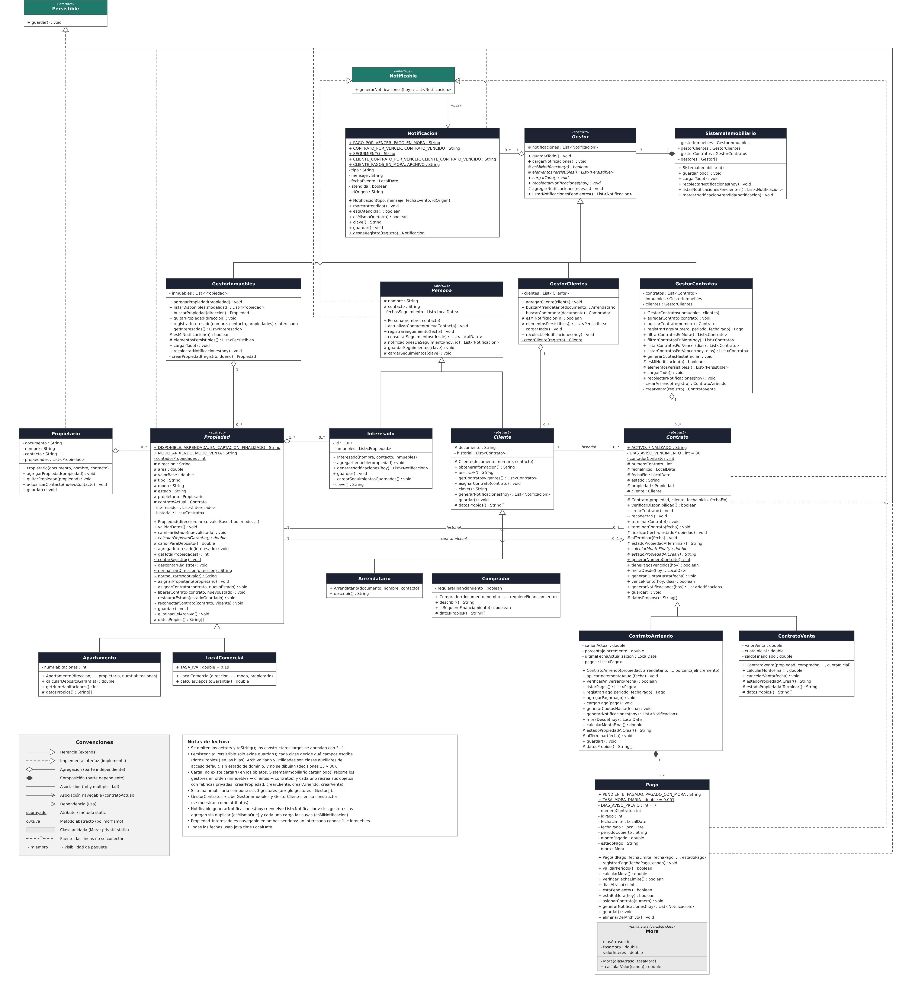

# Cómo funciona el sistema inmobiliario

Documento para todo el grupo, también para quienes no participaron en las decisiones de diseño. Se puede leer sin conocer el código ni el historial del proyecto. Sirve para preparar la sustentación y para que el equipo de la interfaz JavaFX sepa cómo usar el sistema.

**Cómo leerlo**
- Las secciones 1 y 2 dan el panorama. Con eso ya se puede explicar el sistema en cinco minutos.
- La sección 3 explica cada clase en lenguaje del negocio.
- Las secciones 4 y 5 explican con ejemplos reales cómo se guarda la información y cómo funcionan los avisos.
- Las secciones 6 a 9 sirven para preparar la sustentación: decisiones, qué muestra y qué omite el UML, glosario y preguntas probables.
- La sección 11 dice **quién explica qué** en la sustentación y qué partes de este documento le sirven a cada uno.
- Las líneas que empiezan con 📄 llevan al código. Son un apoyo: el texto se entiende sin abrirlas.
- Las palabras técnicas (canon, cuota, clave del registro, idOrigen...) están explicadas en el **glosario** (sección 8).
- "Decisión N" remite al registro de decisiones del README (sección 7 de la Entrega 2), donde están las alternativas que se descartaron y por qué.

---

## Índice

1. [Panorama general](#1-panorama-general)
2. [Mapa del UML](#2-mapa-del-uml)
3. [Clase por clase](#3-clase-por-clase)
4. [Persistencia: cómo se guarda y se carga la información](#4-persistencia-cómo-se-guarda-y-se-carga-la-información)
5. [Notificaciones: un caso de principio a fin](#5-notificaciones-un-caso-de-principio-a-fin)
6. [El porqué de las decisiones](#6-el-porqué-de-las-decisiones)
7. [El UML frente al código: qué muestra y qué omite](#7-el-uml-frente-al-código-qué-muestra-y-qué-omite)
8. [Glosario](#8-glosario)
9. [Posibles preguntas de la sustentación](#9-posibles-preguntas-de-la-sustentación)
10. [Anexo: cómo usar el sistema desde la interfaz JavaFX](#10-anexo-cómo-usar-el-sistema-desde-la-interfaz-javafx)
11. [Reparto de la sustentación: quién explica qué](#11-reparto-de-la-sustentación-quién-explica-qué)

---

## 1. Panorama general

### 1.1 Qué problema resuelve

Un **agente inmobiliario** administra apartamentos y locales de **varios dueños**, en arriendo o en venta. Hoy lo hace a mano, en hojas de cálculo y cuadernos, y eso le trae dos problemas:

- **Dinero que se pierde:** calcula a mano el incremento anual del arriendo y los intereses por pagar tarde, así que se equivoca u olvida cobrarlos.
- **Clientes que se pierden:** no tiene un lugar donde ver qué contratos están por vencer ni a qué interesados debe volver a llamar.

El sistema guarda todo en un solo lugar, **hace los cálculos solo** (incremento anual, mora, depósito de garantía) y **le avisa al agente** lo que requiere atención: pagos atrasados o por vencer, contratos que terminan y citas de seguimiento.

### 1.2 Las cuatro piezas principales

Una forma sencilla de imaginarlo es una oficina con un coordinador y tres archivadores:

```
                         ┌──────────────────────────────┐
                         │      SistemaInmobiliario     │  ← el coordinador: crea los tres
                         │   (la puerta de entrada)     │    gestores y les da órdenes en orden
                         └──────────────┬───────────────┘
              ┌─────────────────────────┼─────────────────────────┐
              ▼                         ▼                         ▼
   ┌────────────────────┐   ┌────────────────────┐   ┌────────────────────┐
   │  GestorInmuebles   │   │   GestorClientes   │   │  GestorContratos   │
   │ propiedades,       │   │ arrendatarios y    │   │ contratos de       │
   │ sus dueños y sus   │   │ compradores        │   │ arriendo y venta,  │
   │ interesados        │   │                    │   │ con sus pagos      │
   └────────────────────┘   └────────────────────┘   └────────────────────┘
        cada gestor guarda además sus propios avisos (notificaciones)
```

| Pieza | Qué hace en una frase |
|---|---|
| `SistemaInmobiliario` | Crea los tres gestores y los coordina: guardar todo, cargar todo y revisar avisos. |
| `GestorInmuebles` | Lleva el inventario de propiedades. No deja registrar dos con la misma dirección. |
| `GestorClientes` | Lleva la lista de arrendatarios y compradores. No deja repetir un documento. |
| `GestorContratos` | Es el único que crea contratos. Registra pagos y responde quién está en mora o qué contratos vencen pronto. |

### 1.3 El ciclo de vida del programa

```
   ┌─────────┐     ┌──────────────────┐     ┌─────────────────────────┐     ┌──────────────────┐     ┌─────────┐
   │  ABRIR  │ ──► │  CARGAR          │ ──► │  USAR                   │ ──► │  GUARDAR         │ ──► │ CERRAR  │
   │         │     │  cargarTodo()    │     │  registrar, pagar,      │     │  guardarTodo()   │     │         │
   │         │     │  lee los .txt y  │     │  consultar, revisar     │     │  escribe la      │     │         │
   │         │     │  arma todo en    │     │  avisos...              │     │  memoria en los  │     │         │
   │         │     │  memoria         │     │  (solo cambia la        │     │  .txt            │     │         │
   │         │     │                  │     │  memoria)               │     │                  │     │         │
   └─────────┘     └──────────────────┘     └─────────────────────────┘     └──────────────────┘     └─────────┘
                       archivos → memoria          todo en memoria              memoria → archivos
```

Tres ideas resumen todo el funcionamiento:

1. **Al abrir**, el sistema lee los archivos `.txt` de la carpeta `datos/` y arma en memoria todos los objetos (propiedades, clientes, contratos...).
2. **Mientras se usa**, todo ocurre en memoria. Las búsquedas y consultas no leen los archivos.
3. **Al guardar**, la memoria se escribe en los archivos. Lo que no se guarda se pierde al cerrar, salvo tres acciones que se guardan solas (sección 4.6).

Además, cada objeto sabe **guardarse a sí mismo** (interfaz `Persistible`) y sabe **decir qué requiere atención** (interfaz `Notificable`). Los gestores solo recorren sus objetos y se los piden.

---

## 2. Mapa del UML

El diagrama completo está en [Diagrama_Clases_Inmobinarios_final.jpg](Diagrama_Clases_Inmobinarios_final.jpg) (imagen grande: conviene abrirla y acercarse a cada zona). **Coincide con el código actual** (actualizado el 23-11-2026, después de las decisiones 29 a 53).



Tiene 19 clases, 2 interfaces y 1 clase anidada (`Mora`, dentro de `Pago`). Para leerlo sin perderse, se divide en cuatro zonas:

| Zona del diagrama | Qué contiene |
|---|---|
| Arriba al centro y a la derecha | `Persistible`, `Notificable`, `Notificacion`, `Gestor` y `SistemaInmobiliario` |
| Fila del medio | Los tres gestores y `Persona`, cada uno justo encima de lo que administra |
| Fila de abajo | El negocio: `Propietario`, `Propiedad`, `Interesado`, `Cliente` y `Contrato` con sus hijas |
| Esquina inferior | `Pago` con `Mora` anidada, la leyenda "Convenciones" y las notas de lectura |

Las líneas punteadas largas que rodean el diagrama son las dos interfaces: cada clase que las implementa tiene una línea que llega hasta `Persistible` (arriba a la izquierda) o `Notificable` (arriba al centro). Los pequeños arcos en los cruces significan "estas líneas no se tocan". Esta es la versión simplificada:

**Gestión** (quién coordina y quién agrupa a quién):

```
SistemaInmobiliario ◆──(3)── Gestor «abstracta» ◇──(0..*)── Notificacion
                                  △
           ┌──────────────────────┼──────────────────────┐
    GestorInmuebles         GestorClientes         GestorContratos
           ◇ 0..*                 ◇ 0..*                 ◇ 0..*
       Propiedad               Cliente                Contrato
```

**Herencia** (quién es un tipo de quién):

```
Propiedad «abstracta»       Persona «abstracta»                  Contrato «abstracta»
   △                           △                                    △
   ├── Apartamento             ├── Interesado                       ├── ContratoArriendo ◆──(0..*)── Pago [Mora anidada]
   └── LocalComercial          └── Cliente «abstracta»              └── ContratoVenta
                                      △
                                      ├── Arrendatario
                                      └── Comprador
```

**Relaciones entre el negocio** (quién conoce a quién):

```
Propietario  1 ◇──── 0..*  Propiedad                      (un dueño, varios inmuebles)
Propiedad 1..* ───── 0..*  Interesado                     (una propiedad tiene 0 o más interesados; un interesado pregunta por 1 o más inmuebles)
Propiedad    1 ───── 0..*  Contrato   (historial)         (todos los contratos que ha tenido)
Propiedad    1 ─────► 0..1 Contrato   (contratoActual)    (el contrato que la ocupa hoy)
Cliente      1 ───── 0..*  Contrato   (historial)         (puede tener varios vigentes a la vez)
```

**Interfaces** (lo que saben hacer clases que no son parientes):

```
«interface» Persistible  → guardar()                  la implementan Propietario, Propiedad, Persona,
                                                      Contrato, Pago y Notificacion
«interface» Notificable  → generarNotificaciones(hoy) la implementan Persona, Contrato y Pago
              └──«usa»──► Notificacion
```

Cómo leer los símbolos:

| Símbolo | Nombre | Qué significa | Ejemplo en el sistema |
|---|---|---|---|
| `△` | Herencia | "es un tipo de" | Un `Apartamento` es una `Propiedad` |
| línea punteada a una «interface» | Implementación | "sabe hacer lo que pide la interfaz" | `Pago` sabe guardarse (`Persistible`) |
| `◇` | Agregación | "agrupa a", pero las partes pueden existir solas | El gestor agrupa propiedades; un propietario agrupa sus propiedades |
| `◆` | Composición | "está hecho de"; las partes no existen sin el todo | Un `ContratoArriendo` contiene sus `Pago`: no hay pago sin contrato |
| `──►` | Asociación navegable | "conoce a" en una dirección | La propiedad conoce su `contratoActual` |
| `1`, `0..*`, `0..1`, `1..*` | Multiplicidad | cuántos objetos del lado **donde está el número** se relacionan con **uno** del otro lado | Pegado a `Contrato` dice `0..1` en `contratoActual`: una propiedad tiene 0 o 1 contrato actual |
| `+` `#` `-` `~` | Visibilidad | público, protegido, privado, de paquete | `- pagos` es privado de `ContratoArriendo` |
| subrayado | Estático | pertenece a la clase, no a cada objeto | `contadorContratos` |
| *cursiva* | Abstracto | se declara aquí y lo implementa cada hija | `calcularDepositoGarantia()` |

---

## 3. Clase por clase

Cada ficha responde cuatro preguntas: **qué representa** en el negocio, **qué guarda**, **qué hace** y **con quién se relaciona** según el UML.

### 3.1 Inmuebles

#### `Propiedad` (abstracta)
- **Qué representa:** un inmueble que el agente ofrece. Es abstracta: en la realidad nunca hay "una propiedad" a secas, siempre es un apartamento o un local.
- **Qué guarda:** dirección, área, valor base (el canon mensual si está en arriendo o el precio si está en venta), tipo, modo (Arriendo o Venta), estado (disponible, arrendada, en captación o finalizado), su propietario, el contrato actual, el historial de contratos y sus interesados.
- **Qué hace:**
  - Valida sus datos al crearse: área y valor mayores a cero, modo válido y propietario obligatorio.
  - Deja que el agente la cambie solo entre "disponible" y "en captación". Los estados "arrendada" y "finalizado" solo los pone un contrato, así nadie puede liberar a mano una propiedad ocupada.
  - Normaliza la dirección: "Calle 100  # 15 - 20" y "Calle 100 #15-20" se reconocen como la misma.
  - Lleva un contador de cuántas propiedades hay registradas (atributo estático).
- **Relaciones UML:** madre de `Apartamento` y `LocalComercial` (herencia). Pertenece a 1 `Propietario` (agregación). Tiene 0..* `Interesado`, un `historial` 0..* de `Contrato` y un `contratoActual` 0..1. La agrupa `GestorInmuebles`.
- 📄 [Propiedad.java](../src/Propiedad.java): constructor [L44](../src/Propiedad.java#L44), `validarDatos()` [L64](../src/Propiedad.java#L64), `cambiarEstado()` [L94](../src/Propiedad.java#L94).

#### `Apartamento`
- **Qué representa:** un apartamento. Guarda además su número de habitaciones (mínimo 1).
- **Qué hace:** calcula su depósito de garantía como **1 mes de canon**.
- **Relaciones UML:** hija de `Propiedad`.
- 📄 [Apartamento.java:18](../src/Apartamento.java#L18).

#### `LocalComercial`
- **Qué representa:** un local comercial. Tiene la constante `TASA_IVA = 0.19`.
- **Qué hace:** calcula su depósito de garantía como **2 meses de canon + IVA**.
- **Relaciones UML:** hija de `Propiedad`.
- **Dato para la sustentación:** quien pide el depósito no pregunta si es apartamento o local; cada clase responde a su manera. Eso es **polimorfismo** (RF-14).
- 📄 [LocalComercial.java:16](../src/LocalComercial.java#L16).

### 3.2 Personas

#### `Persona` (abstracta)
- **Qué representa:** lo que tienen en común los clientes y los interesados: nombre, contacto y **fechas de seguimiento** (las citas o llamadas pendientes del agente con esa persona).
- **Qué hace:** registra citas (sin repetir fechas), lista las citas pendientes en orden y genera un aviso por cada cita de hoy o vencida.
- **Relaciones UML:** madre de `Cliente` e `Interesado`. Implementa `Persistible` y `Notificable`.
- **Por qué existe:** antes, `Cliente` e `Interesado` repetían ese mismo código. Ahora se escribe una sola vez (decisión 10).
- 📄 [Persona.java](../src/Persona.java): `registrarSeguimiento()` [L33](../src/Persona.java#L33), avisos de seguimiento [L66](../src/Persona.java#L66).

#### `Cliente` (abstracta)
- **Qué representa:** alguien que ya firmó o va a firmar un contrato.
- **Qué guarda:** su documento (solo los números: "52.111.222" se guarda como "52111222") y el historial de sus contratos.
- **Qué hace:** dice cuáles de sus contratos siguen vigentes (puede tener varios a la vez) y avisa sus citas, sus contratos por vencer o vencidos y sus pagos atrasados.
- **Relaciones UML:** hija de `Persona`, madre de `Arrendatario` y `Comprador`. Se asocia con 0..* `Contrato` (historial). La agrupa `GestorClientes`.
- 📄 [Cliente.java](../src/Cliente.java): contratos vigentes [L48](../src/Cliente.java#L48), avisos [L65](../src/Cliente.java#L65).

#### `Arrendatario`
- **Qué representa:** el cliente que toma un inmueble en arriendo.
- **Relaciones UML:** hija de `Cliente`. Un `ContratoArriendo` exige un `Arrendatario`, así que el programa no compila si se intenta arrendarle a un comprador.

#### `Comprador`
- **Qué representa:** el cliente que compra. Guarda si **requiere financiamiento**; si no lo requiere, tiene que pagar el total como cuota inicial.
- **Relaciones UML:** hija de `Cliente`.

#### `Interesado`
- **Qué representa:** una persona que preguntó por uno o más inmuebles y **todavía no es cliente**.
- **Qué guarda:** un identificador único (porque no se le pide documento) y la lista de inmuebles que le interesan (**mínimo uno**).
- **Qué hace:** avisa sus citas de seguimiento. Si se registra otra vez con el mismo contacto, no se duplica: se le suman los inmuebles nuevos.
- **Relaciones UML:** hija de `Persona`. Se relaciona con `Propiedad` en los dos sentidos: 0..* interesados por propiedad y 1..* propiedades por interesado.
- 📄 [Interesado.java](../src/Interesado.java); se registra con [GestorInmuebles.java:123](../src/GestorInmuebles.java#L123).

#### `Propietario`
- **Qué representa:** el dueño de uno o más inmuebles. El agente no es dueño: representa a varios propietarios.
- **Qué guarda:** documento, nombre, contacto y sus propiedades.
- **Relaciones UML:** agrega 0..* `Propiedad`. No hereda de `Persona` porque el agente no le hace seguimientos. No tiene gestor propio: se registra junto con su propiedad (decisión 32).
- 📄 [Propietario.java](../src/Propietario.java).

### 3.3 Contratos y pagos

#### `Contrato` (abstracta)
- **Qué representa:** un negocio firmado entre una propiedad y un cliente.
- **Qué guarda:** número (consecutivo y automático), fecha de inicio, fecha de fin, estado, la propiedad y el cliente.
- **Ciclo de vida:**
  ```
  recién construido (sin número) ──► el gestor lo registra ──► "activo" ──► se termina o se cancela ──► "finalizado"
  ```
- **Qué hace:**
  - Al registrarse verifica que la propiedad esté disponible. Si está arrendada, lo rechaza y dice qué contrato la ocupa (RF-04).
  - Le asigna su número y ocupa la propiedad.
  - Al terminar, libera la propiedad (RF-10).
  - Dice si vence pronto, regla que usan la consulta de contratos por vencer y los avisos.
- **Relaciones UML:** madre de `ContratoArriendo` y `ContratoVenta`. Conoce 1 `Propiedad` y 1 `Cliente`. La agrupa `GestorContratos`.
- 📄 [Contrato.java](../src/Contrato.java): crear [L80](../src/Contrato.java#L80), terminar [L122](../src/Contrato.java#L122), vence pronto [L190](../src/Contrato.java#L190).

#### `ContratoArriendo`
- **Qué representa:** un arriendo. Es el único contrato con canon, incremento anual y pagos mensuales.
- **Qué guarda:** canon actual, porcentaje de incremento anual, fecha del último incremento y su lista de pagos.
- **Qué hace:**
  - **Crea las cuotas solo:** una por mes, que vence el mismo día del mes en que empezó el contrato.
  - **Sube el canon solo** cada vez que se cumple un año (RF-07).
  - **Registra el pago** de un mes y calcula la mora si se paga tarde (RF-05, RF-06).
  - Lista el historial de pagos ordenado por fecha (RF-08).
  - Al terminar antes de tiempo, borra las cuotas futuras que ya no se deben.
- **Relaciones UML:** hija de `Contrato`. **Composición** con `Pago` (◆): los pagos son parte del contrato y no existen sin él.
- 📄 [ContratoArriendo.java](../src/ContratoArriendo.java): incremento [L60](../src/ContratoArriendo.java#L60), cuotas [L200](../src/ContratoArriendo.java#L200), registrar pago [L106](../src/ContratoArriendo.java#L106).

#### `ContratoVenta`
- **Qué representa:** una venta. Guarda el valor de venta, la cuota inicial y el saldo financiado. No tiene pagos mensuales.
- **Qué hace:** al firmarse, la propiedad queda como vendida ("finalizado"). Terminar el contrato es cerrar la venta. Si el comprador desiste, `cancelarVenta()` devuelve la propiedad a "disponible".
- **Relaciones UML:** hija de `Contrato`. Exige un `Comprador`.
- 📄 [ContratoVenta.java](../src/ContratoVenta.java).

#### `Pago` y su clase anidada `Mora`
- **Qué representa:** **una cuota mensual** de un arriendo, por ejemplo "la cuota de diciembre del contrato 2".
- **Qué guarda:** número de pago, fecha límite, fecha en que se pagó (vacía mientras no se pague), mes que cubre, monto y estado: `pendiente`, `pagado` o `pagado con mora`.
- **Qué hace:**
  - Se marca como pagada.
  - Si se pagó después de la fecha límite, crea una `Mora` que calcula el interés: **canon × 0,1 % × días de atraso**.
  - Avisa si está atrasada o si vence en los próximos 7 días.
- **Relaciones UML:** parte de `ContratoArriendo` (composición ◆). `Mora` está **dentro** de `Pago` (recuadro gris en el diagrama).
- 📄 [Pago.java](../src/Pago.java): registrar [L76](../src/Pago.java#L76), cálculo de la mora [L244](../src/Pago.java#L244), avisos [L154](../src/Pago.java#L154).

### 3.4 Avisos

#### `Notificable` (interfaz)
- **Qué representa:** la capacidad de "decir qué requiere atención a una fecha dada". Tiene un solo método: `generarNotificaciones(hoy)`.
- **Quién la implementa:** `Pago`, `Contrato` y `Persona` (y por herencia `Cliente` e `Interesado`).

#### `Notificacion`
- **Qué representa:** un aviso para el agente, como un post-it.
- **Qué guarda:** tipo, mensaje, fecha del hecho, quién lo generó (`idOrigen`) y si ya fue atendido.
- **Qué hace:** se marca como atendido, se guarda y reconoce si otro aviso es "el mismo".
- **Relaciones UML:** la agrupa `Gestor` (0..*). `Notificable` la «usa». Implementa `Persistible`.
- Se explica en detalle en la sección 5.

### 3.5 Gestión

#### `Gestor` (abstracta)
- **Qué representa:** lo que los tres gestores hacen igual: guardar todos sus objetos, cargar sus avisos, agregar avisos sin duplicarlos y listar los pendientes.
- **Lo que cada hijo debe completar:** qué objetos guarda, cómo los carga, cómo recolecta sus avisos y cuáles avisos son suyos.
- **Relaciones UML:** madre de los tres gestores. Agrupa 0..* `Notificacion`.
- 📄 [Gestor.java](../src/Gestor.java).

#### `GestorInmuebles`
- **Qué hace:** registra propiedades (sin direcciones repetidas), lista las disponibles por modalidad (RF-13), busca por dirección, quita una propiedad registrada por error (solo si nunca tuvo contratos ni interesados) y registra interesados (RF-11).
- **Relaciones UML:** hijo de `Gestor`. Agrupa 0..* `Propiedad`.
- 📄 [GestorInmuebles.java](../src/GestorInmuebles.java).

#### `GestorClientes`
- **Qué hace:** registra clientes (sin documentos repetidos del mismo tipo) y busca arrendatarios o compradores por documento, con o sin puntos.
- **Relaciones UML:** hijo de `Gestor`. Agrupa 0..* `Cliente`.
- 📄 [GestorClientes.java](../src/GestorClientes.java).

#### `GestorContratos`
- **Qué hace:**
  - Es **el único punto para crear contratos**: verifica que la propiedad y el cliente estén registrados.
  - Registra pagos por número de contrato (RF-05).
  - Lista los contratos en mora (RF-09) y los que vencen pronto (RF-15).
- **Relaciones UML:** hijo de `Gestor`. Agrupa 0..* `Contrato`. Conoce a los otros dos gestores para hacer sus verificaciones.
- 📄 [GestorContratos.java](../src/GestorContratos.java).

#### `SistemaInmobiliario`
- **Qué representa:** la puerta de entrada del programa. La interfaz JavaFX solo necesita hablar con esta clase y con los gestores que ella entrega.
- **Qué hace:** crea los tres gestores con sus dependencias; carga y guarda todo en el orden correcto; revisa los avisos de todos, los junta y los ordena; y marca un aviso como atendido.
- **Relaciones UML:** **composición** con 3 `Gestor` (◆): los gestores nacen y mueren con el sistema.
- 📄 [SistemaInmobiliario.java](../src/SistemaInmobiliario.java).

### 3.6 Herramientas (no aparecen en el UML)

| Clase | Qué hace | Por qué no está en el UML |
|---|---|---|
| `ArchivoPlano` | Es la única clase que abre archivos: escribe, busca, borra y lee líneas | Es una herramienta técnica, no un concepto del negocio (decisión 15) |
| `Utilidades` | Valida documentos (5 a 12 dígitos) y contactos (teléfono o correo), y da formato a montos ("$2.500.000") | Igual: es una herramienta (decisión 30) |
| `Main` | Demostración de todos los requerimientos con datos de ejemplo. **Sobrescribe `datos/` cada vez que se ejecuta** | Es un programa de prueba |
| `PruebasRF01aRF03` | Pruebas automáticas de RF-01 a RF-03; no guarda nada | Es un programa de prueba |

### 3.7 Cómo se mantienen sincronizadas las relaciones (los métodos `~`)

Varias relaciones se conocen **por los dos lados**: la propiedad sabe cuál es su contrato y el contrato sabe cuál es su propiedad; el propietario sabe sus propiedades y cada propiedad sabe su dueño. Si cualquiera pudiera cambiar un lado sin avisar al otro, quedarían datos contradictorios (una propiedad "arrendada" sin contrato, por ejemplo).

Por eso los métodos que enlazan o desenlazan son de **acceso de paquete** (en el UML llevan `~`, en el código no llevan `public`). Eso significa que solo las clases del propio sistema pueden llamarlos, y cada uno lo llama **una sola clase concreta**, que se encarga de cambiar los dos lados juntos. Es **encapsulamiento** (decisión 13): el estado solo cambia por los caminos previstos.

| Método `~` | Quién lo llama | Qué deja consistente |
|---|---|---|
| `Propiedad.asignarPropietario()` | `Propietario.agregarPropiedad()` | La propiedad queda con su dueño; si ya tenía otro, lanza error |
| `Propietario.quitarPropiedad()` | `GestorInmuebles.quitarPropiedad()` | Una propiedad quitada por error sale también de la lista del dueño |
| `Propiedad.asignarContrato()` | `Contrato.crearContrato()` | `contratoActual`, `historial` y estado de la propiedad cambian **en un solo paso** |
| `Propiedad.liberarContrato()` | `Contrato.terminarContrato()` y `cancelarVenta()` | Quita el `contratoActual` y deja la propiedad en el estado correcto |
| `Cliente.asignarContrato()` | `Contrato.crearContrato()` | El contrato entra al historial del cliente |
| `Propiedad.agregarInteresado()` e `Interesado.agregarInmueble()` | `GestorInmuebles.registrarInteresado()` | El enlace propiedad ↔ interesado queda en los dos sentidos |
| `Propiedad.restaurarEstado()`, `Propiedad.reconectarContrato()`, `Contrato.reconectar()`, `ContratoArriendo.cargarPago()`, `Pago.asignarContrato()` | Solo la carga (`cargarTodo()`) | Reconstruyen las relaciones tal como estaban guardadas, sin pasar por las validaciones de un contrato nuevo |
| `Propiedad.contarRegistro()` y `descontarRegistro()` (estáticos) | `GestorInmuebles` | Mantienen el contador de propiedades registradas |

**Idea para la sustentación:** el agente (o la interfaz) nunca dice "pon esta propiedad como arrendada". Crea un contrato, y el contrato es el que ocupa la propiedad. Así la regla de que una propiedad arrendada no admite otro contrato (RF-04) no se puede saltar.

### 3.8 Ciclo de vida de un contrato y de la propiedad

Este es el recorrido más importante del sistema y toca cuatro clases. Ejemplo: el agente arrienda el *Calle 45 #10-05 Apto 101* a Ana Gómez.

**Crear (RF-03 y RF-04)** → `GestorContratos.agregarContrato(contrato)`

```
1. El agente construye un ContratoArriendo (todavía sin número y con estado null: no existe para el sistema).
2. GestorContratos.agregarContrato() verifica que la propiedad esté en el inventario
   y que el cliente esté registrado.
3. Llama a contrato.crearContrato(), que revisa la propiedad:
      · si está "arrendada"  → error que dice qué contrato la ocupa (RF-04)
      · si no está "disponible" → error con su estado actual
4. Si todo está bien:
      · el contrato recibe su número consecutivo y el estado "activo"
      · propiedad.asignarContrato(): contratoActual = este contrato, entra al historial y
        la propiedad pasa a "arrendada" (o "finalizado" si es una venta)
      · cliente.asignarContrato(): entra al historial del cliente
5. El gestor agrega el contrato a su lista.
```

Cada tipo de contrato decide el estado en que deja la propiedad (`estadoPropiedadAlCrear()`): el arriendo la deja "arrendada" y la venta "finalizado". Es **polimorfismo**: `Contrato` no pregunta de qué tipo es.

**Terminar (RF-10)** → `contrato.terminarContrato(fecha)`

```
1. Solo se puede terminar un contrato "activo", con una fecha posterior a su inicio.
2. alTerminar(fecha): cada tipo hace lo suyo. El arriendo borra las cuotas pendientes
   que ya no se deben (también del archivo de pagos); la venta no hace nada.
3. Si la fecha es antes del fin previsto, fechaFin pasa a ser esa fecha.
4. propiedad.liberarContrato(): contratoActual queda vacío y la propiedad toma el estado
   que dice el contrato (estadoPropiedadAlTerminar()).
5. El contrato queda "finalizado" y se conserva en el historial de la propiedad y del cliente.
```

**Cómo cambia el estado de la propiedad**

| Estado | Cómo se llega | Cómo se sale |
|---|---|---|
| `en captación` | El agente la registra así o la cambia a mano | A mano, a `disponible` |
| `disponible` | El agente la registra así o la cambia a mano; también al terminar un arriendo o cancelar una venta | Crear un contrato, o a mano a `en captación` |
| `arrendada` | Solo al crear un `ContratoArriendo` | Solo al terminar ese contrato (vuelve a `disponible`) |
| `finalizado` (vendida) | Solo al crear un `ContratoVenta` | No se sale: una venta cerrada no se vuelve a ofrecer. Si el comprador desiste, `cancelarVenta()` la devuelve a `disponible` |

`Propiedad.cambiarEstado()` solo acepta pasar entre `disponible` y `en captación`, y lanza error si la propiedad tiene un contrato vigente o ya fue vendida.

📄 [Contrato.java:80](../src/Contrato.java#L80) (crear), [Contrato.java:122](../src/Contrato.java#L122) (terminar), [Propiedad.java:94](../src/Propiedad.java#L94) (`cambiarEstado`), [GestorContratos.java](../src/GestorContratos.java) (`agregarContrato`).

---

## 4. Persistencia: cómo se guarda y se carga la información

**Persistir** quiere decir que la información sobreviva cuando se cierra el programa (RNF-01). Aquí se hace con **archivos de texto plano** en la carpeta `datos/`.

### 4.1 Qué archivo guarda cada cosa

| Archivo | Qué guarda | Una línea por cada... |
|---|---|---|
| `propietarios.txt` | Dueños | propietario |
| `propiedades.txt` | Inmuebles | propiedad |
| `interesados.txt` | Interesados y los inmuebles que les interesan | interesado |
| `clientes.txt` | Arrendatarios y compradores | cliente |
| `seguimientos.txt` | Fechas de citas de clientes e interesados | persona |
| `contratos.txt` | Contratos de arriendo y de venta | contrato |
| `pagos.txt` | Cuotas mensuales de los arriendos | cuota |
| `notificaciones.txt` | Avisos, atendidos o no | aviso |

La carpeta `datos/` no se sube a git: cada integrante tiene sus propios datos de prueba.

### 4.2 Cómo se lee una línea

Reglas del formato:
1. **Una línea = un objeto.**
2. **Los campos se separan con `|`.**
3. **El primer campo es la clave del registro**: el dato que identifica al objeto, como una cédula. Con ella el sistema encuentra la línea para reemplazarla o borrarla.
4. **Las relaciones se guardan como claves, no como objetos completos.** Un contrato no copia la propiedad entera: guarda su dirección.
5. Un campo vacío se ve como `||`.

**Ejemplo 1: un contrato de arriendo** (`contratos.txt`)

```text
2|ContratoArriendo|2026-11-21|2027-11-21|activo|Calle 45 #10-05 Apto 101|52111222|1900000.0|0.05|2026-11-21
```

| Posición | Valor | Significa |
|---|---|---|
| 1 (clave) | `2` | Contrato número 2 |
| 2 | `ContratoArriendo` | Tipo de contrato: le dice al sistema qué clase crear al cargar |
| 3 | `2026-11-21` | Fecha de inicio |
| 4 | `2027-11-21` | Fecha de fin |
| 5 | `activo` | Estado |
| 6 | `Calle 45 #10-05 Apto 101` | **Referencia** a la propiedad (su dirección) |
| 7 | `52111222` | **Referencia** al cliente (su documento) |
| 8 | `1900000.0` | Canon actual ($1.900.000) |
| 9 | `0.05` | Incremento anual del 5 % |
| 10 | `2026-11-21` | Fecha del último incremento |

Los campos 1 a 7 los escribe la clase madre `Contrato` y son iguales para cualquier contrato. Los campos 8 a 10 los agrega la hija `ContratoArriendo`. Un `ContratoVenta` agrega en su lugar valor de venta, cuota inicial y saldo:

```text
3|ContratoVenta|2026-11-21|2027-01-21|finalizado|Calle 80 #30-12 Apto 502|41555666|3.5E8|7.0E7|2.8E8
```

(`3.5E8` es la forma en que Java escribe 350.000.000.)

**Ejemplo 2: una cuota** (`pagos.txt`)

```text
2:2|2026-12-21||2026-12|0.0|pendiente
```

Se lee así: la clave `2:2` es "pago 2 del contrato 2", vence el 21-12-2026, la fecha de pago está vacía (`||`) porque todavía no se ha pagado, cubre el mes 2026-12, el monto pagado es 0 y el estado es `pendiente`. La clave junta los dos números porque el número de pago solo es único dentro de su contrato.

**Ejemplo 3: una propiedad** (`propiedades.txt`)

```text
Carrera 7 #45-10 Local 2|50.0|4000000.0|Local comercial|Arriendo|arrendada|100200300|4
Calle 100 #15-20 Apto 301|80.0|2500000.0|Apartamento|Arriendo|disponible|100200300||3
```

Campos: dirección (clave), área, valor base, tipo, modo, estado, documento del dueño, número del contrato actual y, solo en apartamentos, el número de habitaciones. El local está ocupado por el contrato 4. El apartamento no tiene contrato (`||`) y tiene 3 habitaciones.

**Las demás líneas**

```text
propietarios.txt    100200300|Carlos Rojas|3001234567
clientes.txt        Arrendatario:52111222|52111222|Ana Gómez|ana@correo.com
                    Comprador:41555666|41555666|Marta Díaz|marta@correo.com|true      ← true = requiere financiamiento
interesados.txt     cf6bf6b5-...|Sofía Ruiz|3125550000|Calle 80 #30-12 Apto 502|Calle 45 #10-05 Apto 101
seguimientos.txt    Arrendatario:79333444|2026-11-28                                   ← clave de la persona y sus citas
                    INTERESADO:cf6bf6b5-...|2026-11-16|2026-12-01
notificaciones.txt  PAGO_EN_MORA:PAGO:2:2:2026-12-21|PAGO_EN_MORA|Pago 2 del contrato 2 ...|2026-12-21|PAGO:2:2|false
```

En `clientes.txt` la clave es `Tipo:documento` (`Arrendatario:52111222`) porque la misma persona puede ser arrendatario de un inmueble y comprador de otro (decisión 31).

### 4.3 Guardar: de la memoria a los archivos

Lo dispara `sistema.guardarTodo()`:

```
SistemaInmobiliario.guardarTodo()
 ├─ GestorInmuebles  → cada Propiedad.guardar(), cada Propietario.guardar() (una vez),
 │                     cada Interesado.guardar() (con sus citas), y sus notificaciones
 ├─ GestorClientes   → cada Cliente.guardar() (con sus citas), y sus notificaciones
 └─ GestorContratos  → cada Contrato.guardar()
                         └─ si es arriendo: cada Pago.guardar()   ← composición: el contrato guarda sus pagos
                       y sus notificaciones
```

Cada `guardar()` le entrega su línea a `ArchivoPlano`, que hace lo siguiente:
1. Lee el archivo.
2. **Si ya existe una línea con la misma clave, la reemplaza. Si no, la agrega al final.**
3. Vuelve a escribir el archivo.

Dos consecuencias importantes:
- **Guardar nunca vacía los archivos** (decisión 47). Si algo falla a mitad, lo ya guardado no se pierde.
- **Por eso, que algo desaparezca de la memoria no lo borra del archivo.** Los únicos borrados son los explícitos de la sección 4.6.

📄 [Gestor.java:18](../src/Gestor.java#L18), [ArchivoPlano.java:29](../src/ArchivoPlano.java#L29).

### 4.4 Cargar: de los archivos a la memoria

Lo dispara `sistema.cargarTodo()`, **una sola vez al abrir el programa y con el sistema vacío**. El sistema lee cada línea y **vuelve a crear el objeto** con `new`, como si el agente lo registrara otra vez, pero con los datos tal como quedaron guardados.

El orden importa: **inmuebles → clientes → contratos**. Un contrato guarda la dirección de su propiedad y el documento de su cliente, así que para convertir esos textos en objetos, la propiedad y el cliente ya deben existir en memoria.

```
1. GestorInmuebles.cargarTodo()
     propietarios.txt  → crea cada Propietario
     propiedades.txt   → crea Apartamento o LocalComercial según el campo "tipo"
                         lo enlaza con su dueño y le devuelve su estado guardado (p. ej. "arrendada")
     interesados.txt   → crea cada Interesado, lo enlaza con sus propiedades y le carga sus citas
   + sus notificaciones (las que empiezan por INTERESADO:)

2. GestorClientes.cargarTodo()
     clientes.txt      → crea Arrendatario o Comprador según el inicio de la clave
     seguimientos.txt  → le devuelve a cada cliente sus citas
   + sus notificaciones (las que empiezan por CLIENTE:)

3. GestorContratos.cargarTodo()
     contratos.txt     → crea ContratoArriendo o ContratoVenta, conservando número, estado y canon
                         busca su propiedad (por dirección) y su cliente (por documento)
                         y reconecta las relaciones: contratoActual e historiales
     pagos.txt         → crea cada Pago y lo mete dentro de su contrato
   + sus notificaciones (las que empiezan por PAGO: o CONTRATO:)
```

Detalles útiles:
- La decisión de qué clase crear según el texto (¿apartamento o local?, ¿arriendo o venta?) se toma en **un solo lugar por gestor**, llamado **fábrica** (decisión 24). Después de crearse, el resto del sistema trata a cada objeto sin preguntar su tipo.
- Los **contadores** se ajustan solos: el próximo contrato nuevo recibe el número siguiente al mayor que se cargó, así que no pisa uno existente.
- Si una línea está dañada (por ejemplo, un contrato que apunta a una propiedad que no existe), la carga se detiene y el mensaje dice qué línea falló. El sistema nunca queda cargado a medias.

📄 [GestorInmuebles.java:194](../src/GestorInmuebles.java#L194), [GestorClientes.java:71](../src/GestorClientes.java#L71), [GestorContratos.java:135](../src/GestorContratos.java#L135), [Contrato.java:106](../src/Contrato.java#L106) (reconectar).

### 4.5 Después de cargar, todo vive en memoria

Al terminar la carga, **cada gestor tiene su lista** y los objetos ya están conectados entre sí:

| Gestor | Lista en memoria | Relaciones ya conectadas |
|---|---|---|
| `GestorInmuebles` | `inmuebles` | propiedad ↔ dueño, propiedad ↔ interesados |
| `GestorClientes` | `clientes` | — |
| `GestorContratos` | `contratos` | contrato → propiedad y cliente; contrato actual e historiales; pagos dentro de cada arriendo |
| los tres | `notificaciones` | — |

Desde ese momento, **todas las búsquedas y consultas recorren estas listas y no vuelven a leer los archivos**. A esto lo llamamos "la caché": una copia de los datos en memoria, rápida de consultar.

### 4.6 Lo que hace el usuario cambia solo la memoria

**Regla:** registrar, pagar, terminar un contrato o agendar una cita cambia los objetos en memoria **al instante**, pero el archivo **no cambia hasta que se llama a `guardarTodo()`**. Si se cierra el programa sin guardar, esos cambios se pierden.

| El usuario... | Qué cambia en memoria |
|---|---|
| Registra una propiedad | Se agrega al inventario y a la lista de su dueño |
| Registra un cliente | Se agrega a la lista de clientes |
| Registra un interesado | Se enlaza con sus inmuebles |
| Agenda una cita | Se agrega a las fechas de seguimiento de la persona |
| Crea un contrato | Recibe número y estado "activo"; la propiedad pasa a "arrendada" (o "finalizado" si es venta) |
| Registra un pago | La cuota pasa a "pagado" o "pagado con mora", con su interés |
| Termina un contrato | Pasa a "finalizado" y la propiedad queda libre (o vendida, si es venta) |
| Revisa avisos | Se crean las cuotas que falten y los avisos nuevos |

**Las tres excepciones que escriben en el archivo de inmediato**, sin esperar a `guardarTodo()`:

| Acción | Qué escribe al instante | Por qué |
|---|---|---|
| **Marcar una notificación como atendida** | Guarda ese aviso con `atendida = true` | Para que no vuelva a aparecer si el programa se cierra antes de guardar |
| **Quitar una propiedad** registrada por error | **Borra** su línea de `propiedades.txt` | `guardarTodo()` nunca borra: si no se borrara aquí, la propiedad reaparecería al reiniciar |
| **Terminar un arriendo antes de tiempo** | **Borra** de `pagos.txt` las cuotas pendientes que ya no se deben | Igual: si no, volverían a aparecer como deuda |

📄 [SistemaInmobiliario.java:69](../src/SistemaInmobiliario.java#L69), [GestorInmuebles.java:76](../src/GestorInmuebles.java#L76), [ContratoArriendo.java:240](../src/ContratoArriendo.java#L240).

### 4.7 Reglas de oro para la interfaz

1. **Cargar una vez al abrir:** `new SistemaInmobiliario()` y luego `cargarTodo()`.
2. **Nunca guardar sin haber cargado antes.** Si se arranca vacío y se guarda, el primer contrato nuevo recibe el número 1 y **reemplaza** la línea del contrato 1 que ya existía. `Main` lo hace a propósito porque es una demostración que arma sus datos desde cero.
3. **Guardar después de cada cambio**, o como mínimo al cerrar la ventana.
4. **Para "recargar", crear un sistema nuevo** y llamar a `cargarTodo()`. No hay forma de recargar un objeto suelto (decisión 53).

---

## 5. Notificaciones: un caso de principio a fin

### 5.1 La idea

El agente no debería revisar contrato por contrato para saber qué está pendiente. Cada objeto que puede preocuparle sabe generar sus propios avisos, y el sistema los junta.

| Quién avisa | Cuándo | Tipo de aviso |
|---|---|---|
| Una **cuota** (`Pago`) | Vence en 7 días o menos / ya pasó su fecha sin pagarse | `PAGO_POR_VENCER` / `PAGO_EN_MORA` |
| Un **contrato** | Termina en 30 días o menos / ya terminó y sigue activo | `CONTRATO_POR_VENCER` / `CONTRATO_VENCIDO` |
| Un **interesado** | Tiene una cita hoy o vencida | `SEGUIMIENTO` |
| Un **cliente** | Cita hoy o vencida; un contrato suyo por vencer o vencido; cuotas en mora | `SEGUIMIENTO`, `CLIENTE_CONTRATO_POR_VENCER`, `CLIENTE_CONTRATO_VENCIDO`, `CLIENTE_PAGOS_EN_MORA` |

Cada aviso guarda:
- **`fechaEvento`:** la fecha del **hecho** (la fecha límite de la cuota, el fin del contrato, el día de la cita), no la fecha de hoy.
- **`idOrigen`:** quién lo generó, por ejemplo `PAGO:2:2` (pago 2 del contrato 2). Por el inicio del `idOrigen` se sabe a qué gestor pertenece: `PAGO:` y `CONTRATO:` a contratos, `CLIENTE:` a clientes, `INTERESADO:` a inmuebles.

Los avisos de un cliente repiten a propósito hechos de sus pagos y contratos, pero desde el punto de vista del cliente, para que el agente sepa a quién llamar (decisión 28).

### 5.2 El caso completo

**Situación:** Ana Gómez arrienda el *Calle 45 #10-05 Apto 101* con el **contrato 2**: empieza el 21-11-2026 con un canon de **$1.900.000**, así que cada cuota vence el día 21. Ana pagó noviembre. Seguimos la **cuota de diciembre**.

---

**Paso 1 · 18-12-2026: el agente abre "Avisos" → `sistema.recolectarNotificaciones(hoy)`**

El sistema hace tres cosas, en este orden:

1. **Prepara las cuotas.** Una cuota solo puede avisar si existe, y las cuotas no se crean todas al firmar sino a medida que se acercan sus fechas. El sistema crea las que vencen hasta dentro de 7 días. Aparece en memoria la cuota de diciembre:
   ```text
   2:2|2026-12-21||2026-12|0.0|pendiente
   ```
2. **Recolecta.** Cada gestor le pregunta a cada uno de sus objetos "¿qué te preocupa hoy?". La cuota responde: "vence el 21-12, dentro de 7 días".
3. **Agrega sin duplicar.** Como no había un aviso igual, lo guarda en la lista del gestor de contratos:
   ```
   tipo: PAGO_POR_VENCER   origen: PAGO:2:2   fechaEvento: 2026-12-21   atendida: no
   "Pago 2 del contrato 2 (periodo 2026-12) vence el 2026-12-21."
   ```

**Paso 2 · 19-12: el agente vuelve a revisar**

La cuota vuelve a generar el mismo aviso, pero el sistema lo compara con los que ya tiene: **mismo tipo + mismo origen + misma fecha del evento = el mismo aviso**. No se crea otro. (Por eso la fecha del aviso es la del hecho y no la de hoy: si fuera la de hoy, cada día aparecería un aviso "nuevo" del mismo problema.)

**Paso 3 · 23-12: la cuota vence sin pagarse → el agente revisa**

La cuota sigue pendiente y su fecha ya pasó. Aparecen dos avisos **nuevos** (de otro tipo, así que no se confunden con el anterior):

```
PAGO_EN_MORA            origen: PAGO:2:2                              fecha: 2026-12-21
CLIENTE_PAGOS_EN_MORA   origen: CLIENTE:Arrendatario:52111222:CONTRATO:2   fecha: 2026-12-21
"Ana Gómez: el contrato 2 (Calle 45 #10-05 Apto 101) tiene pagos en mora desde el 2026-12-21."
```

`sistema.listarNotificacionesPendientes()` le muestra al agente los avisos no atendidos de los tres gestores, del más antiguo al más reciente.

**Paso 4 · 23-12: el agente llama a Ana y marca el aviso como atendido → `sistema.marcarNotificacionAtendida(aviso)`**

El aviso pasa a `atendida = true` y **se escribe en el archivo de inmediato** (es una de las tres excepciones). En `notificaciones.txt` queda:

```text
PAGO_EN_MORA:PAGO:2:2:2026-12-21|PAGO_EN_MORA|Pago 2 del contrato 2 (periodo 2026-12) en mora desde el 2026-12-21.|2026-12-21|PAGO:2:2|true
```

La clave (primer campo) es `tipo:origen:fecha`. El último campo, `true`, significa "atendida". Ese aviso ya no sale en la lista de pendientes.

**Paso 5 · el agente cierra el programa (con `guardarTodo()`) y lo vuelve a abrir al día siguiente**

1. `cargarTodo()` lee `notificaciones.txt` y recupera **todos** los avisos, **incluidos los atendidos**.
2. El agente revisa avisos. Como Ana todavía no ha pagado, la cuota vuelve a generar el aviso de mora.
3. El sistema lo compara con los que cargó: ya existe uno igual (tipo, origen y fecha) marcado como atendido. **No se crea uno nuevo y no reaparece en pendientes.**

Por eso se cargan también los avisos atendidos: sin ellos, el sistema no podría reconocer que el agente ya se ocupó de ese aviso.

**Paso 6 · el 26-12 Ana paga → `gestorContratos.registrarPago(2, "2026-12", 26-12-2026)`**

Pagó 5 días tarde, así que el sistema calcula la mora:
```
interés = canon × tasa diaria × días = 1.900.000 × 0,001 × 5 = $9.500
monto   = 1.900.000 + 9.500        = $1.909.500
```
En memoria, y en el archivo después de `guardarTodo()`:
```text
2:2|2026-12-21|2026-12-26|2026-12|1909500.0|pagado con mora
```
Desde ese momento la cuota no genera más avisos, porque ya no está pendiente.

**Para Diseño y Calidad:** un aviso **no se borra solo** cuando el problema se resuelve. Si el agente no había marcado el `CLIENTE_PAGOS_EN_MORA`, este sigue en pendientes hasta que lo marque. Conviene que la pantalla de pagos invite a marcar los avisos relacionados.

📄 Recolectar [SistemaInmobiliario.java:48](../src/SistemaInmobiliario.java#L48) · evitar duplicados [Gestor.java:62](../src/Gestor.java#L62) y [Notificacion.java:55](../src/Notificacion.java#L55) · aviso de la cuota [Pago.java:154](../src/Pago.java#L154) · aviso del cliente [Cliente.java:65](../src/Cliente.java#L65) · marcar atendido [SistemaInmobiliario.java:69](../src/SistemaInmobiliario.java#L69) · cargar avisos [Gestor.java:30](../src/Gestor.java#L30).

### 5.3 Otras reglas de los avisos

- **Plazos:** 7 días para las cuotas y 30 días para los contratos. Están definidos como constantes en el código.
- **"Por vencer" y "vencido" son avisos distintos** (decisiones 26 y 45). Si el agente atendió "por vencer" y el contrato llega a su fecha sin terminarse, recibe "vencido".
- **Una cita vencida sigue avisando** hasta que se marque el aviso como atendido.
- **Un contrato finalizado no avisa**, y sus cuotas tampoco.
- **Los avisos no tienen prioridad:** se ordenan solo por la fecha del hecho (decisión 6).
- **Revisar avisos cambia datos:** crea cuotas y puede aplicar el incremento anual. Después de revisar hay que guardar.

---

## 6. El porqué de las decisiones

Una línea por decisión. El número remite a la tabla de decisiones del README (sección 7 de la Entrega 2).

**Estructura de clases**

| Decisión | En una línea |
|---|---|
| 1 | `Contrato` es abstracta con dos hijas porque arriendo y venta comparten fechas y estado, pero tienen datos y cálculos distintos. |
| 2 | `Cliente` es abstracta con `Arrendatario` y `Comprador` porque comparten datos, pero el comprador puede requerir financiamiento. |
| 10 | `Persona` existe para no repetir nombre, contacto y seguimientos en `Cliente` e `Interesado`. |
| 3 y 18 | La propiedad tiene `contratoActual` (0..1) e `historial`; el cliente solo historial, porque puede tener varios contratos vigentes a la vez. |
| 12 | La propiedad recibe su propietario al crearse; sin eso la relación dueño–propiedad no se podía construir. |
| 34 | El tipo de propiedad lo fija la subclase, para que no exista un `Apartamento` con tipo "Local". |
| 37 | El interesado tiene un id propio porque no tiene documento y su contacto puede cambiar. |

**Conceptos de la clase (POO)**

| Decisión | En una línea |
|---|---|
| 5 | Se usan **interfaces** (`Notificable`, `Persistible`) y no una clase madre común porque `Pago`, `Contrato` y `Persona` no están emparentados y ya tienen su propia jerarquía. |
| 7 y 9 | `Mora` es una **clase anidada `private static`** porque una mora no existe sin el pago atrasado que la origina y nadie más la usa. Al ser `static` no guarda una referencia oculta al pago. |
| 7 | Los contadores y `TASA_IVA` son **estáticos** porque pertenecen a la clase, no a cada objeto. |
| 13 | **Encapsulamiento:** los atributos solo cambian con métodos del negocio; no hay setters y las listas se entregan como copias o de solo lectura. |
| 21 | `Gestor` es abstracta para escribir una sola vez lo que hacen igual los tres gestores. No usa genéricos porque no se vieron en el curso. |
| 22 | `SistemaInmobiliario` coordina a los gestores porque dependen unos de otros y se deben cargar en orden. Una clase madre no debe conocer a sus hijas. |
| 29 | Los errores se informan con excepciones con mensaje en español, no devolviendo `false`, para que quien usa el sistema sepa qué corregir. |

**Reglas de negocio**

| Decisión | En una línea |
|---|---|
| 19 | `GestorContratos.agregarContrato()` es el único camino para crear contratos; así ninguno queda por fuera de las consultas. |
| 20 y 31 | `GestorClientes` valida documentos repetidos; la clave es `Tipo:documento` para permitir que una persona sea arrendatario y comprador. |
| 25 y 43 | Las cuotas se crean solas cada mes y el incremento anual se aplica solo, porque el dolor del agente era hacerlo a mano. |
| 16 y 39 | Los cálculos reciben "la fecha de hoy" como parámetro para poder demostrarlos y probarlos con fechas fijas. |
| 35 | El canon o el precio salen del valor base de la propiedad, y su modo debe coincidir con el tipo de contrato. |
| 41 | Terminar un contrato lleva fecha; una venta se cierra (queda vendida) o se cancela (vuelve a estar disponible). |
| 44 | El depósito de garantía solo aplica a inmuebles en arriendo. |
| 46 | Un comprador sin financiamiento paga el total como cuota inicial. |
| 48 | Un interesado con un contacto que ya existe no se duplica: se le suman los inmuebles nuevos. |
| 49 | Si la propiedad ya está arrendada, el mensaje dice qué contrato la ocupa (RF-04). |
| 50 | Pagar es pagar la cuota que el sistema ya generó, para no tener dos calendarios en un mismo contrato. |
| 51 | La mora es 0,1 % diario sobre el canon: una sola tasa, simple y basada en los días de atraso. |
| 52 | Un pago tardío siempre queda "pagado con mora"; se quitó `registrarPagoUnico()` porque ningún requerimiento lo pedía y no hacía nada. |

**Persistencia y avisos**

| Decisión | En una línea |
|---|---|
| 15 | Archivos de texto plano con `ArchivoPlano`: lo pide RNF-01 y así no se depende de librerías externas. |
| 23 | Un archivo por tipo de objeto y relaciones guardadas como claves, porque guardar objetos anidados entraría en ciclos (propiedad → contrato → propiedad...). |
| 24 | Al arrancar, los gestores recrean los objetos con fábricas, y la decisión de qué clase crear está en un solo lugar. |
| 47 | Guardar reemplaza línea por línea y nunca vacía los archivos, para no perder datos si algo falla. |
| **53** | **Se quitó `cargar()`** porque nadie lo llamaba (el sistema siempre se recarga completo) y recargar un objeto suelto no reconectaba sus relaciones, lo que habría dejado datos desincronizados en la interfaz. |
| 6 | Los avisos se guardan y se marcan como atendidos, y no tienen prioridad, para no complicar el diseño. |
| 26 y 45 | "Por vencer" y "vencido" son avisos distintos, para que atender uno no oculte el otro. |
| 27 y 28 | El aviso de seguimiento se escribe una vez en `Persona`; el cliente avisa sus contratos y mora desde su punto de vista. |
| 38 | Todos los avisos van en un solo archivo y cada gestor toma los suyos según el inicio del `idOrigen`. |

---

## 7. El UML frente al código: qué muestra y qué omite

El diagrama final **ya refleja el código actual**. Se actualizó después de las decisiones 29 a 53, así que ya no hay clases ni métodos que aparezcan en uno y no en el otro. Lo que sigue explica qué se dibujó a propósito de otra manera, para responder si preguntan.

**Lo que el diagrama omite a propósito**

| Qué no aparece | Por qué |
|---|---|
| `ArchivoPlano` y `Utilidades` | Son herramientas técnicas de acceso de paquete, sin estado de dominio (decisiones 15 y 30) |
| Getters y `toString()` | Solo devuelven datos; dibujarlos llenaría el diagrama sin explicar nada (decisión 13) |
| Los parámetros largos de algunos constructores | Se abrevian con `...` (por ejemplo `Propiedad(direccion, area, valorBase, tipo, modo, ...)`) |
| Métodos privados de apoyo (validaciones, `buscarPagoDelPeriodo()`, etc.) | Son detalles internos; se dibujan solo las fábricas privadas (`crearPropiedad`, `crearCliente`, `crearArriendo`, `crearVenta`) porque explican cómo se carga el sistema |
| `Main` y `PruebasRF01aRF03` | Son programas de demostración y prueba, no parte del modelo |

**Lo que el diagrama dibuja de una manera especial**

| En el diagrama | Cómo leerlo |
|---|---|
| `SistemaInmobiliario` ◆ `Gestor` con multiplicidad `3` | Una sola línea hacia la clase abstracta, porque el código guarda los gestores en un arreglo `Gestor[]`. Los tres gestores concretos aparecen además como atributos del sistema |
| `GestorContratos` sin flechas hacia `GestorInmuebles` y `GestorClientes` | Los recibe en el constructor y los guarda; se muestran como atributos (`- inmuebles`, `- clientes`) para no cruzar medio diagrama |
| `Propiedad` 1..* — 0..* `Interesado` sin flechas | Relación navegable en los dos sentidos: la propiedad tiene `interesados` y el interesado tiene `inmuebles` |
| Dependencia punteada `Notificable` → `Notificacion` «usa» | `Notificable` no tiene un atributo `Notificacion`: solo la devuelve como resultado de `generarNotificaciones(hoy)` |
| `Persona` implementa `Persistible` y `Notificable` pero no dibuja `guardar()` | `Persona` es abstracta y deja `guardar()` a sus hijas (`Cliente` e `Interesado`); sí implementa de verdad los seguimientos |

**Cambios que sufrió el diseño y que el equipo debe conocer** (si alguien tiene una versión vieja del diagrama o del README):

| Antes | Ahora | Decisión |
|---|---|---|
| `Persistible` tenía `guardar()` y `cargar()` | Solo `guardar()`; la carga la hace `cargarTodo()` de cada gestor | 53 |
| Las hijas tenían `aplicarDatosPropios()` | Solo existe `datosPropios()`, que sirve para guardar | 53 |
| `ContratoVenta.registrarPagoUnico()` | Se quitó: ningún requerimiento lo pedía | 52 |
| `crearContrato()` y `validarDatos()` devolvían `boolean` | Devuelven `void` y lanzan una excepción con el motivo | 29 y 53 |
| `Pago.registrarPago()` y `Mora.calcularValor()` sin parámetros | `registrarPago(fechaPago, canon)` y `calcularValor(canon)` | 51 |
| `Cliente.contratoActual` | Se eliminó: un cliente puede tener varios contratos vigentes | 18 |
| `Interesado` solo con nombre y contacto | Con `id` y `inmuebles` (mínimo uno) | 37 |
| `listarNotificacionesPendientes()` lanzaba "Pendiente: RF-20" | Ya devuelve los avisos no atendidos | 38 |

Para la sustentación basta decir: *"El diagrama coincide con el código. Dibujamos el modelo del negocio y dejamos fuera las herramientas técnicas (`ArchivoPlano`, `Utilidades`), los getters y los métodos privados de apoyo; cada cambio frente a la primera versión tiene su decisión registrada en el README."*

---

## 8. Glosario

| Término | Qué significa aquí |
|---|---|
| **Canon** | Lo que paga el arrendatario cada mes. Empieza en el valor base de la propiedad y sube con el incremento anual. |
| **Valor base** | El número que se registra con la propiedad: el canon si está en arriendo o el precio si está en venta. |
| **Cuota** | Un objeto `Pago`: la obligación de pagar el canon de un mes concreto. El sistema las crea solas. |
| **Periodo** | El mes que cubre una cuota, escrito `AAAA-MM` (por ejemplo `2026-12`). |
| **Fecha límite** | Hasta cuándo se puede pagar una cuota sin mora: el mismo día del mes en que empezó el contrato. |
| **Mora** | Estar atrasado: una cuota pendiente cuya fecha límite ya pasó. También es la clase anidada que calcula el interés. |
| **Interés de mora** | Lo que se suma por pagar tarde: canon × 0,1 % × días de atraso. |
| **Incremento anual** | Porcentaje que sube el canon cada vez que el contrato cumple un año. |
| **Depósito de garantía** | Dinero que se exige al arrendar: 1 canon (apartamento) o 2 cánones + IVA (local). |
| **Modo** | Si la propiedad se ofrece en "Arriendo" o en "Venta". |
| **Estado** | Situación de una propiedad (disponible, arrendada, en captación, finalizado), de un contrato (activo, finalizado) o de una cuota (pendiente, pagado, pagado con mora). |
| **En captación** | El agente todavía está preparando el inmueble y aún no lo ofrece. |
| **Seguimiento** | Una fecha en la que el agente debe volver a contactar a un cliente o interesado. |
| **Interesado** | Persona que preguntó por inmuebles y todavía no es cliente. |
| **Gestor** | Clase que guarda la lista de un tipo de objeto y hace las operaciones sobre ella. |
| **Persistir** | Guardar la información para que sobreviva al cierre del programa. |
| **Archivo plano** | Archivo de texto simple, una línea por registro y campos separados por `\|`. |
| **Registro** | Una línea de un archivo plano: un objeto guardado. |
| **Clave del registro** | El primer campo de la línea: el dato único con el que se encuentra el objeto. Por ejemplo, la dirección de una propiedad, `Tipo:documento` de un cliente o `nºContrato:idPago` de una cuota. |
| **Referencia** | Un campo que guarda la clave de otro objeto en lugar del objeto completo (por ejemplo, el contrato guarda la dirección de su propiedad). |
| **Memoria / caché** | Los objetos que el programa tiene cargados mientras está abierto: las listas de los gestores. Las consultas se hacen aquí, no en los archivos. |
| **Fábrica** | Método que lee un texto y decide qué clase crear (por ejemplo, `Apartamento` o `LocalComercial`). |
| **Notificación / aviso** | Un post-it para el agente: algo que requiere su atención. |
| **idOrigen** | Texto que dice quién generó un aviso, por ejemplo `PAGO:2:2` (pago 2 del contrato 2) o `CLIENTE:Arrendatario:52111222`. Sirve para saber a qué gestor pertenece y para no duplicarlo. |
| **fechaEvento** | La fecha del hecho que se avisa (fecha límite, fin del contrato, cita), no la fecha en que se revisó. |
| **Atendida** | El agente ya resolvió el aviso; deja de aparecer en pendientes. |
| **Recolectar** | Pedirle a todos los objetos que generen sus avisos a una fecha dada. |
| **Clase abstracta** | Clase que no se puede crear directamente; sirve de molde para sus hijas (`Propiedad`, `Cliente`, `Contrato`...). |
| **Interfaz** | Lista de métodos que una clase promete saber hacer, sin importar de quién herede. |
| **Clase anidada** | Clase definida dentro de otra (`Mora` dentro de `Pago`). |
| **Estático** | Atributo o método de la clase, compartido por todos sus objetos (por ejemplo, el contador de contratos). |
| **Polimorfismo** | Llamar al mismo método sobre objetos distintos y que cada uno responda a su manera, sin preguntar su tipo. |
| **Agregación (◇)** | "Agrupa a": las partes pueden existir por separado (el gestor y sus propiedades). |
| **Composición (◆)** | "Está hecho de": las partes no existen sin el todo (el contrato de arriendo y sus pagos). |

---

## 9. Posibles preguntas de la sustentación

**¿Por qué `Mora` es una clase anidada?**
Porque una mora no existe sin el pago atrasado que la origina y ninguna otra clase la usa. Al anidarla dentro de `Pago` y hacerla privada, nadie más puede crearla ni verla. Es `static` para no guardar una referencia oculta al pago (decisiones 7 y 9).

**¿Por qué usaron interfaces y no herencia para guardar y avisar?**
Porque las clases que guardan y avisan (`Pago`, `Contrato`, `Persona`...) no son "el mismo tipo de cosa" y cada una ya tiene su propia madre; en Java una clase solo puede heredar de una. Una interfaz no impone una madre: solo exige que la clase sepa hacer algo (decisión 5).

**¿Por qué `Persistible` solo tiene `guardar()` y no `cargar()`?**
Porque `cargar()` nadie lo llamaba. El sistema siempre se carga completo con `cargarTodo()`, que crea los objetos desde los archivos y reconecta sus relaciones. `cargar()` releía un objeto suelto sin reconectar su dueño, contratos ni seguimientos, así que usarlo desde la interfaz habría dejado datos desincronizados (decisión 53). Guardar sí es cosa de cada objeto (sabe qué campos escribir); crear objetos desde un texto es cosa del gestor.

**¿Dónde está el polimorfismo?**
En `calcularDepositoGarantia()` (apartamento y local calculan distinto), `calcularMontoFinal()` (arriendo y venta), `describir()` (arrendatario y comprador), `generarNotificaciones()` (cada objeto avisa lo suyo) y `guardar()`. Quien llama no pregunta de qué tipo es el objeto.

**¿Cuál es la diferencia entre la agregación y la composición en su diagrama?**
Agregación (◇): el gestor agrupa propiedades, pero una propiedad tiene sentido por sí sola. Composición (◆): un pago no existe sin su contrato de arriendo; por eso el contrato guarda sus pagos y el gestor ni los conoce. `SistemaInmobiliario` también compone a sus tres gestores.

**¿Qué pasa si se cierra el programa sin guardar?**
Se pierde lo hecho desde la última vez que se guardó, salvo tres acciones que se escriben solas: marcar un aviso como atendido, quitar una propiedad y las cuotas que se borran al terminar un arriendo.

**¿Cómo evitan que un aviso aparezca repetido?**
Dos avisos son "el mismo" si tienen igual tipo, igual origen e igual fecha del hecho. Antes de agregar uno, el gestor lo compara con los que ya tiene, incluidos los atendidos que se cargaron del archivo.

**¿Cómo se garantiza que no se arriende una propiedad ya arrendada (RF-04)?**
Los contratos solo se crean con `GestorContratos.agregarContrato()`, que verifica que la propiedad esté disponible. El estado "arrendada" solo lo pone un contrato, y el agente no puede cambiarlo a mano mientras haya un contrato vigente.

**¿Por qué archivos de texto y no una base de datos o JSON?**
RNF-01 pide archivos planos, y así el proyecto no depende de librerías externas. Se evaluó JSON con Gson y se descartó (decisión 15).

**¿Por qué los métodos reciben "hoy" como parámetro?**
Para poder demostrar y probar los cálculos con fechas fijas (por ejemplo, simular que pasó un año), sin depender del reloj del computador (decisiones 16 y 39).

**¿Qué haría falta para agregar un nuevo tipo de inmueble, como una casa?**
Crear la clase `Casa` hija de `Propiedad` con su propio `calcularDepositoGarantia()` y agregar un caso en la fábrica de `GestorInmuebles`. El resto del sistema no cambia.

**¿Por qué `Cliente` no tiene contrato actual y `Propiedad` sí?**
Una propiedad solo puede estar ocupada por un contrato a la vez. Un cliente puede arrendar un apartamento y un local al mismo tiempo, así que sus contratos vigentes se calculan desde su historial (decisión 18).

**¿Por qué existe `SistemaInmobiliario` si ya están los gestores?**
Porque los gestores dependen unos de otros (contratos necesita inmuebles y clientes) y se deben cargar en orden. Esa coordinación queda en un solo lugar y la interfaz no tiene que conocerla (decisión 22).

**¿Por qué no se guarda el objeto propiedad completo dentro del contrato?**
Porque la propiedad conoce su contrato y el contrato conoce su propiedad: guardarlos anidados no terminaría nunca. Se guarda solo la clave (la dirección) y al cargar se reconecta (decisión 23).

**¿Cómo se calcula la mora?**
Canon × 0,1 % × días de atraso. Ejemplo: canon de $1.900.000 pagado 2 días tarde = $3.800 de interés, y el estado queda "pagado con mora" (decisión 51).

**¿Qué pasa si un archivo tiene una línea dañada?**
La carga se detiene y el mensaje dice qué registro falló. El sistema nunca queda cargado a medias.

**¿Por qué `ArchivoPlano` y `Utilidades` no están en el diagrama?**
Porque el diagrama modela el negocio (propiedades, clientes, contratos, avisos) y esas dos clases son herramientas técnicas: una abre archivos y la otra valida formatos. No guardan datos del negocio ni se relacionan con él (decisiones 15 y 30).

**¿Qué significa el `~` que aparece en algunos métodos?**
Acceso de paquete: sin `public`, `private` ni `protected`. Lo usamos en los métodos que enlazan objetos entre sí (`asignarContrato()`, `liberarContrato()`, `asignarPropietario()`...), para que solo las clases del sistema puedan llamarlos y siempre en el orden correcto (sección 3.7).

**¿Qué pasa por dentro cuando se crea un contrato?**
`GestorContratos.agregarContrato()` verifica que la propiedad y el cliente estén registrados y llama a `crearContrato()`, que revisa que la propiedad esté disponible (si está arrendada, dice qué contrato la ocupa). Si todo está bien, el contrato recibe su número, queda "activo", ocupa la propiedad y entra al historial del cliente (sección 3.8).

**¿Por qué `Propiedad` e `Interesado` se conocen en los dos sentidos?**
Porque se necesitan las dos preguntas: "¿quién está interesado en este inmueble?" (para ofrecerlo) y "¿en qué inmuebles está interesada esta persona?" (para su seguimiento). El enlace lo crea un solo método, `GestorInmuebles.registrarInteresado()`, para que los dos lados queden iguales (decisión 37).

**¿Cuántas clases tiene el diagrama?**
19 clases (`Propiedad`, `Apartamento`, `LocalComercial`, `Persona`, `Cliente`, `Arrendatario`, `Comprador`, `Interesado`, `Propietario`, `Contrato`, `ContratoArriendo`, `ContratoVenta`, `Pago`, `Notificacion`, `Gestor`, `GestorInmuebles`, `GestorClientes`, `GestorContratos` y `SistemaInmobiliario`), 2 interfaces (`Persistible` y `Notificable`) y 1 clase anidada (`Mora`).

---

## 10. Anexo: cómo usar el sistema desde la interfaz JavaFX

```java
// Al abrir la aplicación (una sola vez)
SistemaInmobiliario sistema = new SistemaInmobiliario();
sistema.cargarTodo();

// Las pantallas usan los gestores
GestorInmuebles inmuebles = sistema.getGestorInmuebles();
GestorClientes clientes = sistema.getGestorClientes();
GestorContratos contratos = sistema.getGestorContratos();

// Toda acción que cambie datos: try/catch y guardar
try {
    contratos.registrarPago(2, "2026-12", LocalDate.now());
    sistema.guardarTodo();
} catch (IllegalArgumentException | IllegalStateException e) {
    mostrarAlerta(e.getMessage());   // los mensajes ya vienen en español y dicen qué corregir
}

// Pantalla de avisos
sistema.recolectarNotificaciones(LocalDate.now());
sistema.guardarTodo();               // revisar avisos crea cuotas y avisos nuevos
List<Notificacion> pendientes = sistema.listarNotificacionesPendientes();
sistema.marcarNotificacionAtendida(seleccionada);   // se guarda sola

// Botón "Recargar"
sistema = new SistemaInmobiliario();
sistema.cargarTodo();
```

`IllegalArgumentException` significa "un dato está mal" (corregir el formulario). `IllegalStateException` significa "no se puede en este momento" (por ejemplo, la propiedad ya está arrendada).

---

## 11. Reparto de la sustentación: quién explica qué

Cada persona tiene una parte. Esta tabla dice qué leer de este documento para prepararla y qué mostrar en el diagrama.

| Integrante | Tema | Qué leer aquí | Qué mostrar en el diagrama |
|---|---|---|---|
| Miguel Delgado | Contexto inicial: el problema, los actores y qué resuelve el sistema | Sección 1 | Mirar el diagrama completo, sin entrar en detalle |
| Santiago Serrano | Clases anidadas (4.3) | `Pago` y `Mora` en 3.3; sección 6 (decisiones 7 y 9); primera pregunta de la sección 9 | El recuadro gris `Mora` dentro de `Pago` |
| Miguel Preciado | Clases, herencia y encapsulamiento (4.1) | 3.1 a 3.3, sección 3.7 (métodos `~`) y decisión 13 | Las tres jerarquías: `Propiedad`, `Persona`/`Cliente` y `Contrato`; los `#`, `-` y `~` |
| Martín Fuentes | Atributos y métodos estáticos (4.2) | Contadores y `TASA_IVA` en 3.1 y 3.3; decisión 7 | Los miembros subrayados: `contadorPropiedades`, `contadorContratos`, `generarNumeroContrato()`, `TASA_IVA`, `TASA_MORA_DIARIA` |
| José Gómez | Polimorfismo (4.5) | `calcularDepositoGarantia()` en 3.1, `calcularMontoFinal()` y `estadoPropiedadAlCrear()` en 3.3 y 3.8, la pregunta "¿Dónde está el polimorfismo?" en 9 | Los métodos en *cursiva* (abstractos) y cómo los implementan las hijas |
| Juanes | Introducción al modelo UML e interfaces (4.4) | Secciones 2 y 3.4, sección 4 (para `Persistible`) y sección 5 (para `Notificable`) | Zonas del diagrama (sección 2), las dos interfaces y sus líneas punteadas |

**Para todos:** conviene haber leído las secciones 1 y 2, y poder responder la pregunta "¿qué hace el sistema?" en dos frases: *"Es un sistema para un agente inmobiliario que guarda propiedades, clientes y contratos, calcula solo el incremento anual y la mora, y le avisa qué requiere atención. Todo se guarda en archivos de texto y se carga completo al abrir."*
